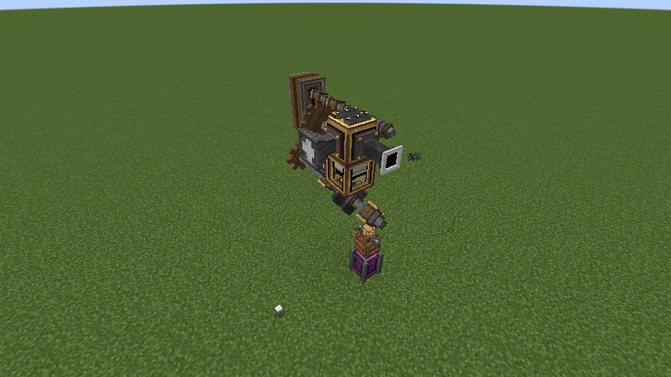
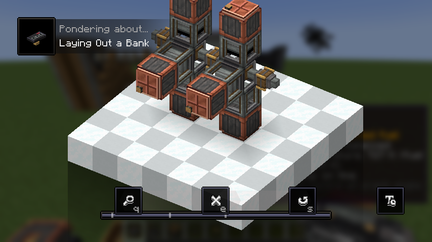
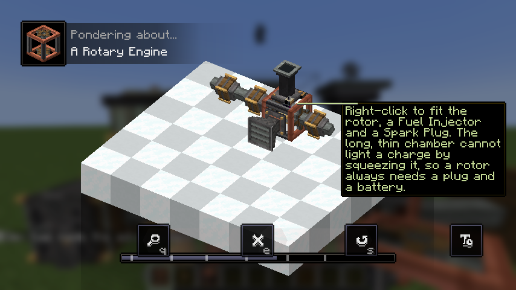
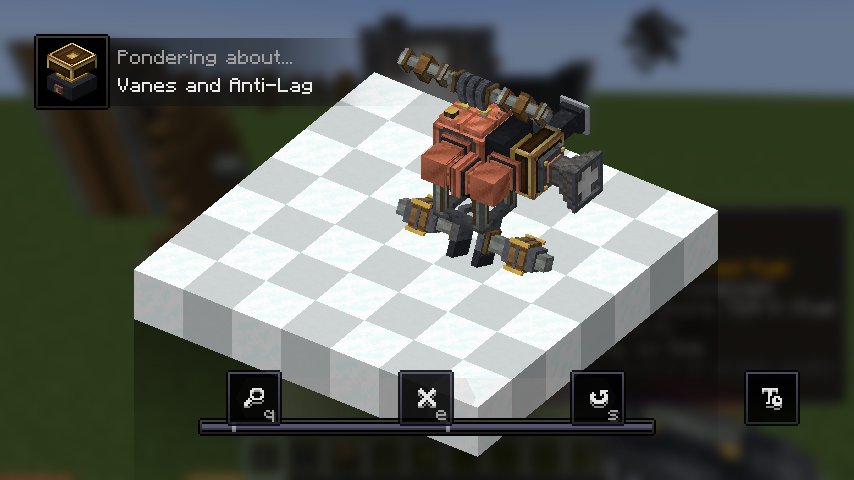

# Create: Engine Engineer

An addon for [Create](https://github.com/Creators-of-Create/Create) that lets you build working internal combustion
engines out of individual parts and turn them into Create rotational force. Start with a crude single cylinder, finish
with a boosted, precision-built V12.

Minecraft 1.21.1 · NeoForge 21.1.219 · Create 6.0.10

> [!WARNING]
> **This mod is vibe coded.** Nearly all of the code, models, Ponder scenes and docs were written by an AI
> (Claude) while directed by a human. It has tests and in-game smoke tests, but expect rough edges, odd balance and
> bugs. Treat it as an experiment, not a polished release, and don't be surprised if worlds or save data break between
> versions.

## Preview


| | |
|---|---|
|  |  |
| Intake and exhaust management | Precision parts |
|  |  |
| Flywheel, dynamometer and turbos | Diagnostics with Engineer's Goggles |

## Features

**Build an engine**
- Crankshafts, throws, cylinders, heads, pistons, rods, camshafts and valves, assembled block by block; cylinders fire
  in order and the crank animates with them
- Inline, V, flat and rotary (Wankel) layouts, with coupled crankshafts for bigger engines
- **Torsional flex**: a crank twists under load, so past eight throws on one unbroken crankshaft an engine's rating
  falls by 4.5 percent a throw. A straight twelve loses about a fifth; a V12 or flat twelve (six throws) loses nothing,
  and cranks geared together one to one count as separate lines. It takes from the rating only, never harms anything
- Cam lobes that sit beside the cylinder block, so a V can run one camshaft in its valley and keep every head face
  free for pipes
- A **Bank Builder** that lays out a whole inline, V or flat bank in one click, and a **Timing Tool** that sets the
  firing order for you

**Feed and tune it**
- Air, fuel and exhaust plumbing with pipes, throttle bodies and fuel metering; diesel, plant oil, gasoline and ethanol
  with spark ignition
- A craftable fuel chain: seeds to plant oil to diesel, sugar crops to ethanol, and biodiesel with glycerin on the
  side, all in Create basins. The loop closes: glycerin goes into engine oil and coolant, and used oil is burned as fuel or recycled into oil or charcoal
- An **Exhaust Heat Exchanger** that turns engine exhaust into basin heat, so an engine can cook its own fuel
- Oil film and lubrication, starters, batteries and alternators
- An **oil sump that is the engine's service port**: one block against the engine takes its oil, its coolant and its
  pilot fuel from any face, so the cylinder heads keep their faces for air and fuel
- **Oil that goes off**: a spent charge drags a little more (never stops or damages anything). Set the sump's Oil
  Exchange dial and a running engine changes its own oil, pushing out **Used Oil** that you burn, refine, coke into
  charcoal or let go. An Oil Filter slows the ageing and cleans fuel out of the oil
- **Engine temperature**: a cold engine drags until it warms through, and a cooled one breathes better (about 4 to 9
  percent more power). Coolant, or just water, goes into the same sump and is spent carrying heat away, so there is no
  radiator to fit. Nothing ever overheats or wears out
- **Dual-fuel pilot injection**: pipe diesel into the sump's pilot tank and a compression engine with no spark plug
  lights gasoline or ethanol with a small pilot shot
- A forgiving early game: spark plug soot clears itself, goggles suggest fuel settings, and the Timing Tool can tune
  every injector in one click
- Governors and MAF sensors for the late game

**Make it powerful**
- Turbochargers (stacked, twin, variable-geometry, with anti-lag), superchargers and intercoolers, with the sound to
  match: a turbo whistle that climbs with the wheel, a blow-off flutter when redstone dumps the boost, anti-lag
  crackle, and a supercharger whine that rises with its shaft
- Precision cylinders, heads, pistons and injectors
- Flywheels that matter: a rough engine is rated for less, and rotating mass smooths it out
- A transmission, and a **Dynamometer** that draws an engine's torque and power curves

**Learn it**
- Engineer's Goggles diagnostics on every part, Ponder scenes for every part, and advancements that reward actually
  using what you build, grouped into tracks (builder, power, tuning, driveline, fuel, service) that each end in a
  capstone, and a Chief Engineer advancement for finishing them all

| | |
|---|---|
|  |  |
|  |  |

## Configuration

The server config (`serverconfig/create_engines-server.toml` in the world) carries the engine calibration plus
`[balance]` multipliers (`fuelConsumption`, `precisionBonus`, `boostStrength`, `rotaryPower`, `heatRecoveryOutput`, `coolingBonus`, `torsionalFlex`)
and `[features]` switches (`forcedInduction`, `sparkFouling`, `oilDilution`, `oilAgeing`, `engineTemperature`,
`pilotInjection`, `rotaryEngines`, `heatRecovery`), so a
modpack can rebalance without code. Turning a feature off never removes blocks; they stop doing that job. The client
config (`engineParticles`, `bangVolume`, `boostVolume`, `effectDensity`) thins out engine sound and particles on a big engine.
Fuel properties are a datapack data map (`data_maps/fluid/fuel.json`), so other mods' fluids can be made into fuels.

## Recommended: raise Create's RPM limit

Create caps rotation at 256 RPM by default, and engines hit that ceiling. We recommend raising it: in
`serverconfig/create-server.toml` (or the world's `serverconfig` folder) under `[kinetics]`, set `maxRotationSpeed` to
something like 1024 or higher. The engine simulation is built to stay cheap at speed, and its torque rating follows the
limit you set. Everything else on the kinetic network still obeys Create's own rules.

## Building

```bash
./gradlew build
```

Other useful tasks: `./gradlew test` (simulation unit tests), `./gradlew runGameTestServer` (in-world GameTests) and
`./gradlew runVisualSmokeTest` (builds an engine and saves screenshots to `run/screenshots/`).

Design notes and how the simulation works are in [docs/DESIGN.md](docs/DESIGN.md).

## License

All Rights Reserved.
