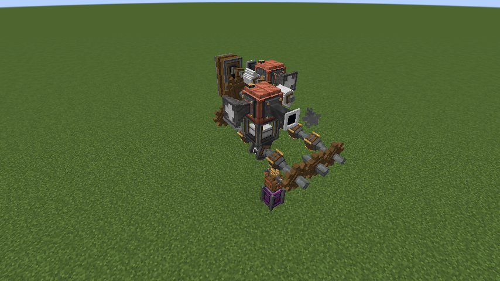
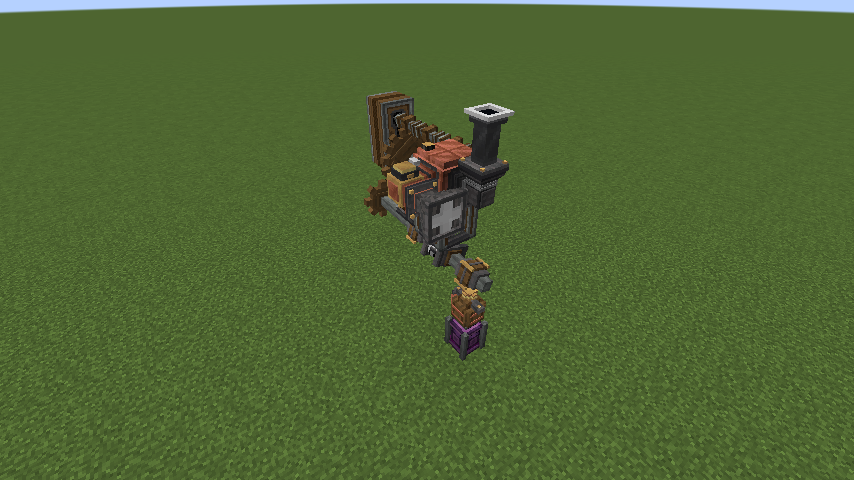
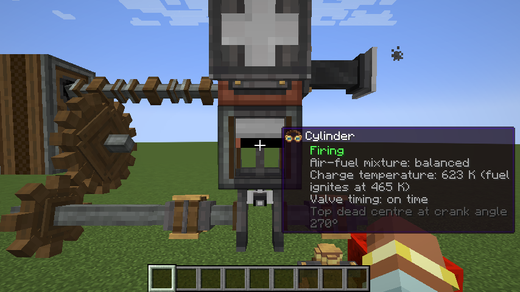
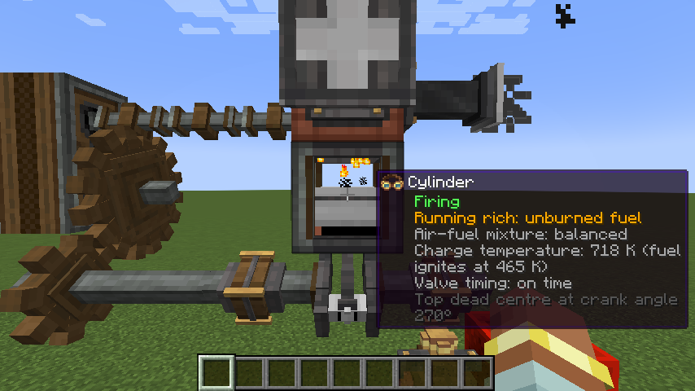
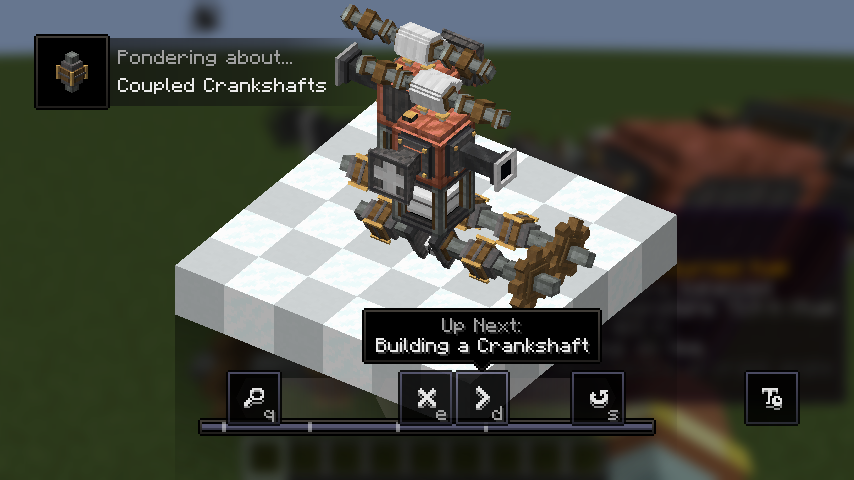
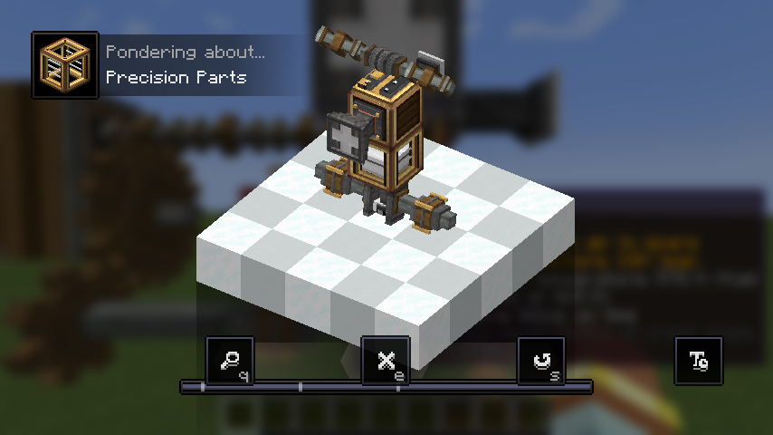

# Create: Engine Engineer

An addon for [Create](https://github.com/Creators-of-Create/Create) that lets you build working internal combustion
engines out of individual parts: crankshafts, cylinders, pistons, connecting rods, camshafts, valves, intake and exhaust
plumbing, fuel and oil. Get them running, tune them, and turn the result into Create rotational force.

Minecraft 1.21.1 · NeoForge 21.1.219 · Create 6.0.10

> [!WARNING]
> **This mod is vibe coded.** Nearly all of the code, models, Ponder scenes and docs were written by an AI
> (Claude) while directed by a human. It has tests and in-game smoke tests, but expect rough edges, odd balance and
> bugs. Treat it as an experiment, not a polished release, and don't be surprised if worlds or save data break between
> versions.

## Preview



| | |
|---|---|
|  |  |
| Engine with intake and exhaust management | Engine built from precision parts |

### Diagnostics with Engineer's Goggles



### Ponder

Every part has Ponder scenes explaining how it works.

| | |
|---|---|
|  |  |
|  | |

## Features

- Engines assembled from real parts, with cylinders that fire in order and a crankshaft that animates with them
- Air, fuel and exhaust plumbing, with pipe manifolds, fuel metering and spark ignition
- Camshafts and valve timing that actually matter; mistime them and the engine suffers
- Oil film and lubrication, starters, flywheels and alternators
- Governors, rev limiters, MAF and lambda sensors, and a timing tool
- Coupled crankshafts and precision parts for bigger, better engines
- Goggle diagnostics and advancements that follow your progress

## Building

```bash
./gradlew build
```

Other useful tasks: `./gradlew test` (simulation unit tests), `./gradlew runGameTestServer` (in-world GameTests) and
`./gradlew runVisualSmokeTest` (builds an engine and saves screenshots to `run/screenshots/`).

Design notes and how the simulation works are in [docs/DESIGN.md](docs/DESIGN.md).

## License

All Rights Reserved.
