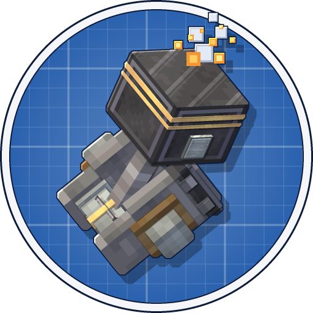
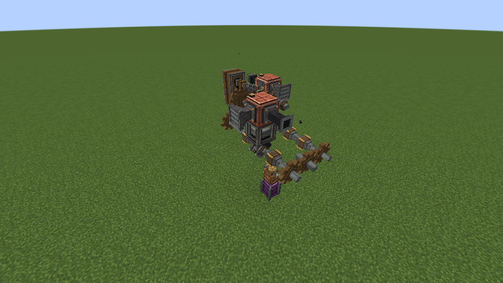
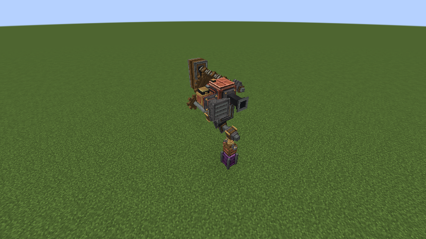
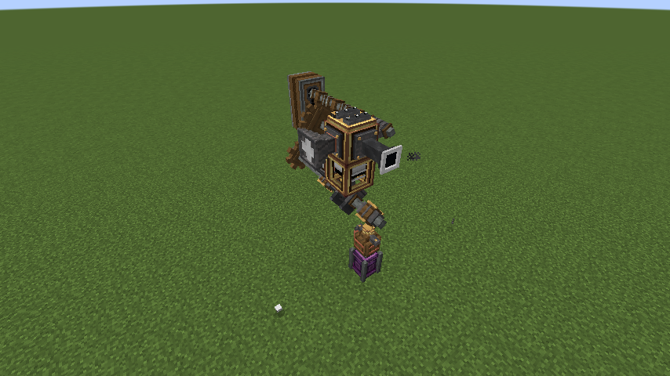
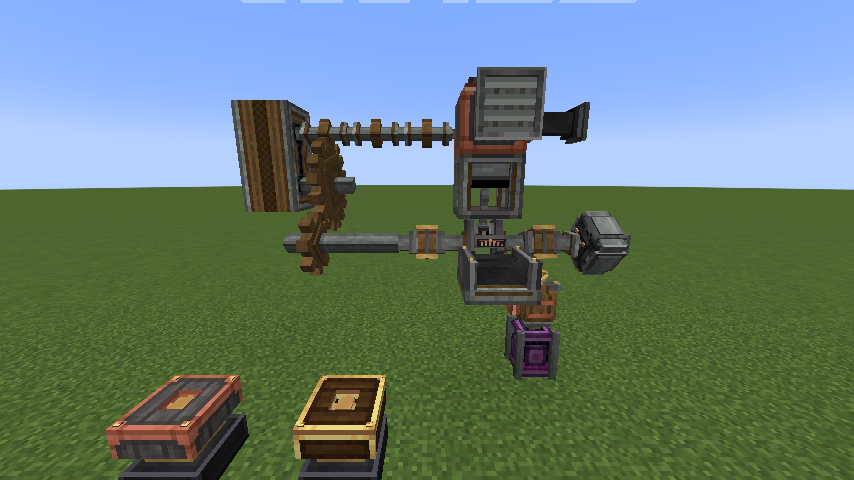
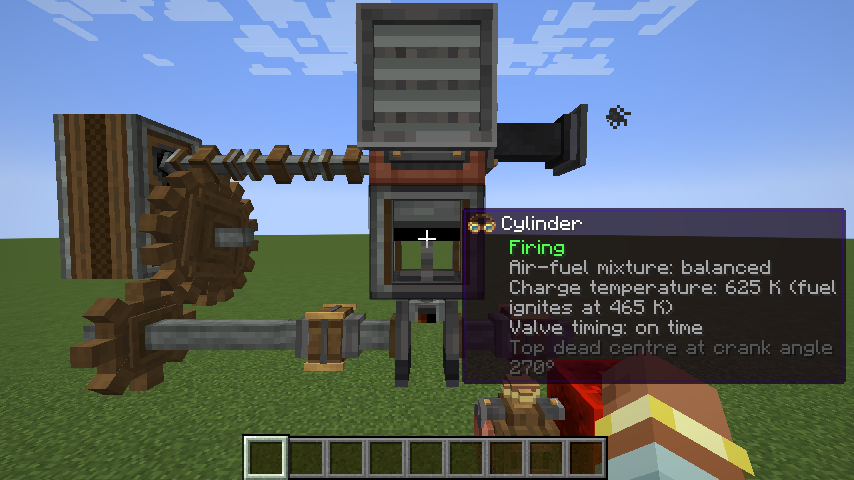
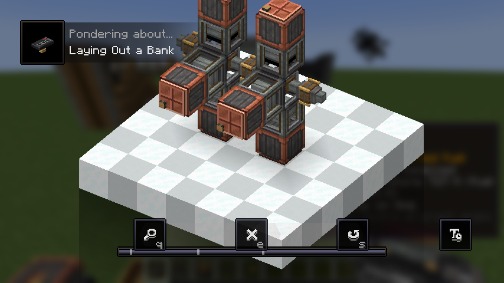
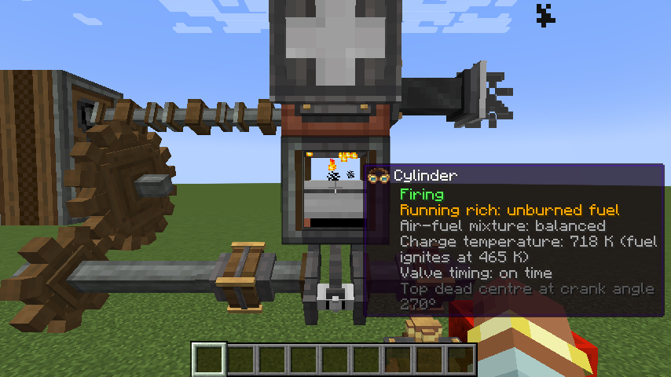
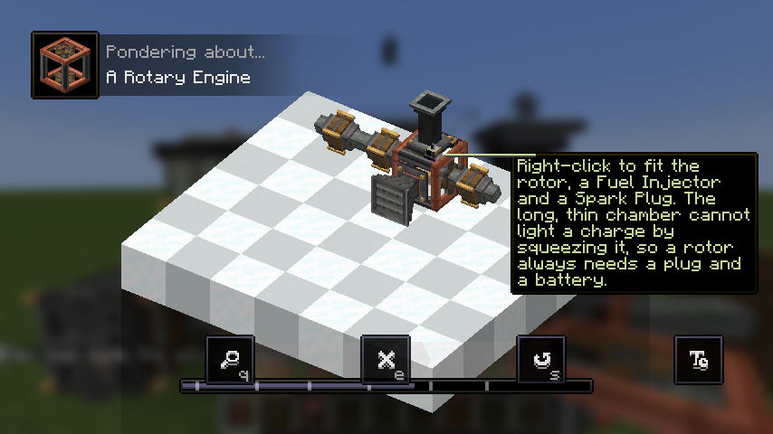
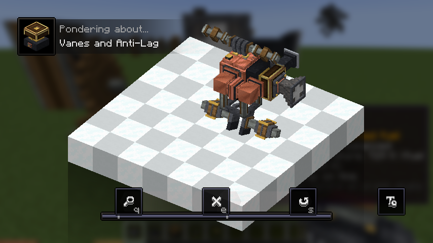

<p align="center"></p>

# Create: Engine Engineer

An addon for [Create](https://github.com/Creators-of-Create/Create) that lets you build working internal combustion
engines out of individual parts and turn them into Create rotational force. Start with a crude single cylinder, finish
with a boosted, precision-built V12.

Minecraft 1.21.1 · NeoForge 21.1.219 · Create 6.0.10

[Discord](https://discord.gg/QYVpy2dqGE)

> [!NOTE]
> **Built with AI.** Nearly all of the code, models, textures, sounds, Ponder scenes and docs were written by an AI
> (Claude) at my direction. I have played, tested and reworked almost all of it over many passes, and it ships with
> unit tests and in-world GameTests. It is still a young mod, but you shouldn't have to expect things to break. If something
> does, please report it on the issue tracker. Block, item and fluid IDs, config keys and ranges, advancement IDs, the
> data-map formats and the public API stay stable within a major version. 2.0 was the one release that renamed things
> (advancement IDs, config files): it carries your advancements, config and casing dye across, and a release that changes how
> an existing engine behaves says so in its changelog.

## Preview



| | |
|---|---|
|  |  |
| Intake and exhaust management | Precision parts |
|  |  |
| Flywheel, dynamometer and turbos | Diagnostics with Engineer's Goggles |

## Features

**Build an engine**
- Crankshafts, throws, cylinders, heads, pistons, rods, camshafts and valves, assembled block by block; cylinders fire
  in order and the crank animates with them
- Inline, V, flat and rotary (Wankel) layouts, with coupled crankshafts for bigger engines
- **Torsional flex**: a crank twists under load, so past eight throws on one unbroken crankshaft an engine's rating
  falls by 2.5 percent a throw, to at most 35 percent. A straight twelve loses about a tenth; a V12 or flat twelve (six throws) loses nothing,
  and cranks geared together one to one count as separate lines. It takes from the rating only, never harms anything
- Cam lobes that sit beside the cylinder block, so a V can run one camshaft in its valley and keep every head face
  free for pipes
- **Breathing with diminishing returns**: each extra intake or exhaust opening on a head adds less than the last (one
  opening per head breathes at about 90 percent, two at about 99), and openings that touch count half, so a tidy layout
  beats a forest of mouths. The loss is mostly at the top of the rev range
- A **Bank Builder** that lays out a whole inline, V or flat bank in one click (it fits the spark plugs you carry, and
  lays a cam line beside the bank if you carry a camshaft and cam lobes), and a **Timing Tool** that sets the
  firing order for you

**Feed and tune it**
- Air, fuel and exhaust plumbing with pipes, throttle bodies (a pedal that can also open past the plain intake, to help a big engine turn faster) and fuel metering; diesel, plant oil, gasoline and ethanol
  with spark ignition
- A craftable fuel chain: seeds to plant oil to diesel, sugar crops to ethanol, and biodiesel with glycerin on the
  side, all in Create basins. The loop closes: glycerin goes into engine oil and coolant, and used oil is burned as fuel or recycled into oil or charcoal
- A **Refining Column**, a multiblock that makes the same fuels better than a basin: a square of Reboilers (1 to 3
  wide) on a Blaze Burner or heat exchanger, layers of Column Sections (which may lean a block to the side, and glow with
  the fluid inside), and Condensers on top. Plant oil to diesel, diesel to gasoline and sugar mash to ethanol, using a
  little catalyst (coal, blaze powder, nether wart) a funnel can feed in. Routes are the data recipe type
  `create_engines:refining`, so a pack can add its own, and JEI and EMI list them. A **Flare Stack** on a working
  Condenser burns a flame, a **Soot Trap** on a rich engine's exhaust catches soot for dye, gunpowder and coal, and a
  **Jerry Can** carries four buckets of a fluid. Basin ethanol is weaker than it was, since the column is the way to make it
- An **Exhaust Heat Exchanger** that turns engine exhaust into basin heat, so an engine can cook its own fuel, and
  into boiler heat, so the exhaust can make steam for Create steam engines on top of the engine's own power
- Oil film and lubrication, starters, batteries and alternators
- Forge Energy out of an alternator, and other mods' fuels (anything tagged `c:diesel`, `c:gasoline`, `c:ethanol` or `c:plantoil`, or given an entry in the fuel data map) in the engines
- An **oil sump that is the engine's service port**: one block against the engine takes its oil, its coolant and its
  pilot fuel from any face, so the cylinder heads keep their faces for air and fuel
- **Oil that goes off**: a spent charge drags a little more (never stops or damages anything). Set the sump's Oil
  Exchange dial and a running engine changes its own oil, pushing out **Used Oil** that you burn, refine, coke into
  charcoal or let go. An Oil Filter slows the ageing and cleans fuel out of the oil
- **Engine temperature**: a cold engine drags until it warms through, and a cooled one breathes better (about 4 to 9
  percent more power). Coolant, or just water, goes into the same sump and is spent carrying heat away, so there is no
  radiator to fit. Nothing ever overheats or wears out
- **Warm-up and cooling**: a cold block burns fuel a little worse (ethanol and pressed oil most, gasoline least) and
  warms quickest at idle. A Blaze Burner against the heat exchanger preheats it. A stopped engine ticks, shimmers and
  its turbine wheel glows red as it cools, and goggles call it Cooling down
- **Plain-language diagnosis**: goggles name an engine Healthy, Running rough or Failing with the one cause to fix
  first, say why a cylinder misfired, and the Dynamometer shows how a new run compares with the last. Two Ponder
  pages cover why an engine will not start and why it runs badly
- **Dual-fuel pilot injection**: pipe diesel into the sump's pilot tank and a compression engine with no spark plug
  lights gasoline or ethanol with a small pilot shot
- A forgiving early game: spark plug soot clears itself, goggles suggest fuel settings, and the Timing Tool can tune
  every injector in one click
- **Blueprints**: a Blueprint records a built engine's layout and every dial, copies the whole tune onto another engine of the
  same build, and shows as a drafting sheet (the plan, the parts, the Maker's Plate figures). A Bank Builder with one in the
  other hand lays the engine out from the parts you carry, it exports as a Create schematic, it copies out as text and pastes
  in again (the server checks every block and dial), and a Framed Blueprint hangs it on a wall
- Governors and MAF sensors for the late game
- **Engine readouts**: a Display Link set against a crankshaft shows an engine's state, speed, load, temperature and
  oil on a display board or nixie tubes, and a comparator reads any of an oil sump's tanks, so a pump or an alarm can
  keep the oil topped up
- Fuel buckets say what they are on hover: their energy, whether they light by compression or need a spark plug, and
  how they take a cold start (other mods' fuels too)

**Make it powerful**
- Turbochargers (stacked, twin, variable-geometry, with anti-lag), superchargers (plain and variable-drive) and intercoolers, with the sound to
  match: a turbo whistle that climbs with the wheel, a blow-off flutter when redstone dumps the boost or the throttle lifts, anti-lag
  crackle, and a supercharger whine that rises with its shaft
- Precision cylinders, heads, pistons and injectors, whose effects are data files a pack can retune
- **Thin air**: above y 128 the air thins (to about 0.85 of sea level at the build limit, and less beyond it), so a
  naturally aspirated engine loses power as it climbs and a turbocharger or supercharger earns its place. It matters most
  for engines on Create Aeronautics aircraft. Engines at or below y 128 are unaffected, and `compat.altitudeThinning`
  turns it off
- Flywheels that matter: a rough engine is rated for less, and rotating mass smooths it out
- A 13-gear transmission with an Auto mode that shifts to suit the engine, and a **Dynamometer** that draws an engine's torque and power curves
- A **Black Box** flight recorder that keeps ten minutes of an engine's speed, load and warmth and says why it stalled
- An exhaust note made up from the engine's speed and firing order, so a V-twin lopes, a six hums and a dead cylinder limps
- A **Muffler** that quiets the note, the bangs and the pops without costing the engine any power, and **Engine Casing**
  that joins into one plate and clads cylinders, pipes, cams, and Create's own shafts and cogwheels to hide the sprawl, in
  plain, riveted, louvred and window styles and any of Create's dye colours. A **Rain Cap** flaps on an exhaust outlet, and
  a **Maker's Plate** carries an engine's name, its builder and the figures from its last Dynamometer run. All of it is
  cosmetic and never changes an engine's rating
- Exhaust that tells the truth: a thin haze when the mixture is right, black when it is rich, white vapour until the
  block warms, a blue cast when fuel has thinned the oil, and a crack of flame when unburned fuel meets a hot pipe.
  Engines cough as they catch and knock as they die, tick as they cool, squeal and spark when they run dry, draw the
  air in at their intakes and steam in the rain. Pistons slap about in their bores by how rough the engine is, a V's
  valley cam shows its pushrods, and every cause the goggles name (rich, lean, a fouled plug, a dry sump, a flood, a
  blocked exhaust, a gasoline pre-ignition rattle, an overload) has a sight or a sound of its own
- Nothing burns underwater: water against a cylinder, a head or a rotor housing stops the engine wherever its pipes
  lead, and so does an intake or exhaust that opens in it. A flood stops an engine; it does not wash it away

**Learn it**
- Engineer's Goggles diagnostics on every part, Ponder scenes for every part, and advancements that reward actually
  using what you build, grouped into tracks (builder, power, tuning, driveline, fuel, service) that each end in a
  capstone, and a Chief Engineer advancement for finishing them all

| | |
|---|---|
|  |  |
|  |  |

## Configuration

The server config (`serverconfig/create_engines-v2-server.toml` in the world) is grouped into `[calibration]`
(`stressPerTorque`, the inertia and friction values), `[limits]` (how far the scanner follows a crankshaft, a manifold or a
coupling), `[balance]` multipliers (`fuelConsumption`, `precisionBonus`, `boostStrength`, `rotaryPower`, `heatRecoveryOutput`,
`coolingBonus`, `torsionalFlex`, `alternatorEnergy`), `[features]` switches (`forcedInduction`, `sparkFouling`, `oilDilution`,
`oilAgeing`, `engineTemperature`, `pilotInjection`, `rotaryEngines`, `heatRecovery`) and `[compat]` (`altitudeThinning`, and
`pollution` and `pollutionRate` for Pollution of the Realms), so a modpack can rebalance without code. Turning a feature off
never removes blocks; they stop doing that job. The first time a world loads in 2.0 it reads the 1.x file
(`create_engines-server.toml`) beside it and carries every value over, and the log says what moved. The client config
(`create_engines-v2-client.toml`: `[effects]` `particles` and `density`, `[volume]` `bang`, `engineNote`, `mechanical` and
`boost`) thins out engine sound and particles on a big engine, and carries its values over the same way.
Fuel properties are a datapack data map (`data_maps/fluid/fuel.json`), so other mods' fluids can be made into fuels.

For pack makers, three config presets ship in the jar (`config_presets/casual.toml`, `standard.toml`, `expert.toml`): copy
their `[balance]` and `[features]` tables over the ones in the config. **Frozen at 2.0 (API version 1.0.0, see docs/API.md):**
parts as data (`part_effects/<part>.json` for the four precision parts, and a part stats data map,
`data_maps/block/part_stats.json`, with optional scales on a cylinder's stats, keyed by `create_engines:cylinder`,
`create_engines:precision_cylinder` or `create_engines:rotor_housing`), and a public API (`com.createengines.api`:
`EngineApi.viewAt`, two events, `EngineStateChangeEvent` and `EngineMilestoneEvent`, on `NeoForge.EVENT_BUS`, and an
extension point, `EngineSourceProvider` with `TorqueSource`, so another mod can put its own kind of engine on a crankshaft,
with boost, goggle lines and blueprint support). JEI and EMI show the refining routes, every fuel and every engine part.

## Works with other mods

All optional; none is needed to play.

- **Create Aeronautics**: the thin-air rule is for it. The mod's GameTests also run alongside Aeronautics 1.3.2 and Sable 2.0.6,
  and one engine on one wheeled contraption has been tried by hand. Other contraptions have not been tried, so treat it as
  early.
- **Pollution of the Realms**: engines put carbon and sulfur into the air through an open exhaust outlet, in proportion to the
  fuel they burn (more carbon when they run rich, less with a Soot Trap fitted; sulfur follows how dirty the fuel is). Nothing
  is read back into the engine. `compat.pollution` and `compat.pollutionRate` control it.
- **KubeJS** (server scripts) and **CC: Tweaked** (a peripheral on a crankshaft, cylinder, head or rotor housing) can watch an
  engine, read-only: see [docs/INTEGRATIONS.md](docs/INTEGRATIONS.md).
- **Jade** shows an engine's state when you look at its crankshaft, cylinder, head or rotor housing.
- **Create Crafts & Additions**: an Alternator's Forge Energy charges its accumulators and motors (tested). Other mods' energy
  blocks should take it too; see [docs/INTEGRATIONS.md](docs/INTEGRATIONS.md) for which were tried.
- **JEI** and **EMI** list every fuel, every refining route and every engine part. Sodium (also with Iris), Sound Physics
  Remastered, AmbientSounds and Flywheel on or off are tested to start and run together; no shader pack was tried.

## For pack makers and addon authors

- **[docs/PACKS.md](docs/PACKS.md)**: the pack maker's guide: rebalance engines, add another mod's fuel, retune parts, add
  refining routes, where the files go, and what to do when something does not work.
- **[docs/CONFIG.md](docs/CONFIG.md)**: every setting with its default and range, the three presets side by side, and where
  the 1.x keys went. **[docs/DATA.md](docs/DATA.md)**: every data file (fuels, part effects, part stats, refining recipes, tags).
- **[docs/ADDONS.md](docs/ADDONS.md)**: the addon author's guide: depend on the mod, write an `EngineSourceProvider` and a
  `TorqueSource` (a working example is built and tested with the mod), listen to engines, and what is frozen.
  **[docs/API.md](docs/API.md)** lists the frozen surface and the API's own version.
- In game, **`/ce`** (game master) shows what the config and the data packs are really doing: `/ce config`, `/ce fuels`,
  `/ce parts`, `/ce api`, and `/ce preset <casual|standard|expert>` (admin) to apply a preset.

## Recommended: raise Create's RPM limit

Create caps rotation at 256 RPM by default, and engines hit that ceiling. We recommend raising it: in
`serverconfig/create-server.toml` (or the world's `serverconfig` folder) under `[kinetics]`, set `maxRotationSpeed` to
512 (higher works too). The engine simulation is built to stay cheap at speed, and its torque rating follows the
limit you set. Everything else on the kinetic network still obeys Create's own rules.

## Building

```bash
./gradlew build
```

Other useful tasks: `./gradlew test` (simulation unit tests), `./gradlew runGameTestServer` (in-world GameTests),
`./gradlew smoke` (unit tests, GameTests and the client audit, each verified; run it in a private copy of the checkout,
see docs/SMOKE.md) and `./gradlew runVisualSmokeTest` (builds an engine and saves screenshots to `run/screenshots/`).

Design notes and how the simulation works are in [docs/DESIGN.md](docs/DESIGN.md). Where the project is going is in
[docs/ROADMAP.md](docs/ROADMAP.md). How a release is checked is in [docs/STABILITY.md](docs/STABILITY.md), with the test
layers in [docs/SMOKE.md](docs/SMOKE.md) and the rules that keep old worlds loading in
[docs/COMPATIBILITY.md](docs/COMPATIBILITY.md). Each release's signed record is in [docs/releases](docs/releases).

## License

[MIT](LICENSE). Use it, change it, ship it in modpacks, no permission needed.
