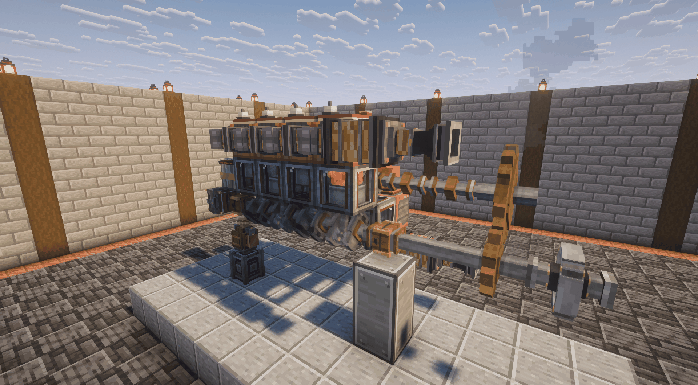

# Release listing (CurseForge / Modrinth)

Copy-paste material for the project pages. Not shipped in the jar.

## Basics

| Field | Value |
|---|---|
| Name | Create: Engine Engineer |
| Slug | create-engine-engineer (check it is free on both sites) |
| Icon | `docs/images/icon.png` (512x512). The jar carries a 256x256 copy as `logo.png` |
| Summary (CurseForge, 250 max) | Build a V8 piece by piece, then hear it fire in order. Working engines for Create: inline, V, flat and Wankel layouts, turbos and superchargers, and an exhaust note made from the engine's own firing order. All of it turns Create rotation. |
| Short description (Modrinth, 256 max) | Same as the summary. |
| Categories | Technology, plus the Create addon tag where the site offers one |
| Game version | 1.21.1 |
| Loader | NeoForge |
| Dependencies | Create 6.0.10 (required). Pollution of the Realms (optional; list it as an optional dependency where the site has one). JEI, EMI, KubeJS, CC: Tweaked, Create Aeronautics, Create Ultimate Factory and Create: The Factory Must Grow are integrations, not dependencies |
| Environment | Client and server (required on both) |
| License | MIT |
| Source | https://github.com/R-unic/create-engines |
| Issues | https://github.com/R-unic/create-engines/issues |
| Release type | Release (stable since 1.0; use Beta or Alpha only for tagged pre-releases, see Publishing) |
| AI disclosure | Yes. The "About this mod" section of the description below, plus the site's own AI-content field where it has one |

Image links in the description use `raw.githubusercontent.com`, so they only work once the repository (with
`docs/images`) is pushed to GitHub. CurseForge's editor wants rich text: paste the description into its source (HTML)
view after converting it, or retype the headings and lists. Modrinth takes the Markdown as it is.

## Description

```markdown
# Create: Engine Engineer

### Build a V8 one part at a time, then hear it fire.



> 🔊 **Turn your sound up.** The exhaust note is made as it plays, from the engine's speed, firing order and build: a V-twin
> lopes, a flat six hums, a crossplane V8 burbles out of its two exhausts, a diesel knocks, a dead cylinder limps, and turbos
> whistle, blow off and crackle.

An addon for **Create** with working internal combustion engines. Place the crankshaft, cylinders, heads, pistons, cams
and valves yourself, pipe in air and fuel, and the engine you built fires in order and drives your Create machines.

- **Start small:** one diesel cylinder and a flywheel, in a forgiving early game
- **Grow:** inline sixes, V8s, flat sixes and Wankels, laid out in a click with the Bank Builder
- **Go big:** turbos, superchargers, a 13-gear transmission and coupled-crank V12s
- **Plays well with others:** burns the fuels of Create: The Factory Must Grow and Create: Diesel Generators, and
  gives Create Aeronautics aircraft something to climb with (see [Works with](#-works-with))

---

## ⚡ At a glance

| | |
|---|---|
| **Layouts** | Inline, V, flat and Wankel, with coupled crankshafts up to a V12 |
| **Fuels** | Diesel, plant oil, gasoline, kerosene, ethanol, methanol and biodiesel, plus other mods' fuels |
| **Power** | Turbos, superchargers, intercoolers, flywheels and a 13-gear transmission |
| **Tools** | Bank Builder, Timing Tool, Blueprints, Dynamometer, Black Box recorder, Engineer's Goggles |
| **Learning** | A Ponder scene for every part, and advancement tracks |
| **Works with** | Create Aeronautics (thin air), Create: Diesel Generators and Create: The Factory Must Grow (fuels), Create Ultimate Factory, Pollution of the Realms, JEI, EMI, KubeJS, CC: Tweaked |
| **For packs and addons** | Config presets, data-driven parts and fuels, a `/ce` command, and a frozen public API |
| **Needs** | Minecraft 1.21.1, NeoForge, Create 6.0.10 (required on client and server) |

---

## 🛣️ From one cylinder to a V12

| Stage | What you build |
|---|---|
| **Start** | A single diesel cylinder and a flywheel. The early game is forgiving: nothing breaks or wears out unless you switch on the wear mode |
| **Grow** | An inline six or a V8, laid out in one click with the Bank Builder, fed by your own plant-oil and ethanol chain |
| **Tune** | Turbos, superchargers, precision parts, a transmission, and the Dynamometer to prove it worked |
| **Master** | Coupled-crank V12s, Wankel rotaries, a Refinery column, and engines that heat your boilers and basins |

---

## 🔧 Build it

- **Real layouts:** inline, V, flat, W, X and rotary (Wankel), with coupled crankshafts for bigger engines
- **Bank Builder:** lays out a whole inline, V, flat, W or X bank in one click (it fits the spark plugs you carry, and lays a
  cam line beside the bank if you carry a camshaft and cam lobes)
- **Timing Tool:** sets the firing order for you, and can tune every injector in one click
- **Blueprints:** record a built engine's layout and every dial, copy the whole tune onto another engine of the same
  build, build it from the parts you carry with the Bank Builder, export it as a Create schematic, share it as text, or hang
  it on a wall in a Framed Blueprint
- **Cams beside the block:** a V can run one camshaft in its valley and keep every head face free for pipes
- **Breathing with diminishing returns:** each extra intake or exhaust opening on a head adds less than the last, and
  openings that touch count half, so a tidy layout beats a forest of mouths
- **Torsional flex:** past eight throws on one unbroken crankshaft an engine's rating falls a little for each extra
  throw, to at most 35 percent. A V12 or flat twelve loses nothing, and nothing is ever harmed

## ⛽ Feed it

- **A fuel chain in Create basins:** seeds to plant oil to diesel, sugar crops to ethanol, and biodiesel with glycerin on
  the side. The loop closes: glycerin goes into engine oil and coolant, and used oil is burned, refined, or recycled
  into oil or charcoal
- **Refining column:** a Refinery of Reboilers, Column Sections and Condensers that makes fuel more efficiently than a
  basin
- **Air, fuel and exhaust plumbing:** pipes, throttle bodies and fuel metering, with spark ignition where the fuel
  needs it
- **Oil sump:** one block against the engine takes its oil, coolant and pilot fuel from any face
- **Oil that goes off:** a running engine can change its own oil, pushing out Used Oil. An Oil Filter slows the ageing
- **Dual-fuel pilot injection:** a compression engine with no spark plug lights gasoline or ethanol with a small pilot
  shot of diesel
- **Exhaust Heat Exchanger:** turns exhaust into basin heat, so an engine can cook its own fuel, and into boiler heat,
  so the exhaust can make steam for Create steam engines
- **Other mods' fuels work:** anything tagged `c:diesel`, `c:gasoline`, `c:ethanol`, `c:kerosene`, `c:methanol`, `c:naphtha` or `c:plantoil`, or given an entry
  in the fuel data map
- Starters, batteries and alternators, with Forge Energy output

## 🚀 Make it powerful

- **Forced induction:** stacked, twin and variable-geometry turbochargers (with anti-lag), plain and variable-drive
  superchargers, and intercoolers
- **Precision parts:** precision cylinders, heads, pistons and injectors
- **Compression:** high compression pistons and rotors for more power without boost, low compression ones for far more
  boost on gasoline, and up to three piston rings on each piston
- **Thin air:** above y 128 the air thins, so a naturally aspirated engine loses power as it climbs and a turbo or
  supercharger earns its place. Made for Create Aeronautics aircraft; engines at or below y 128 are unaffected, and a
  config switch turns it off
- **Flywheels that matter:** a rough engine is rated for less, and rotating mass smooths it out
- **A 13-gear transmission** with an Auto mode that shifts to suit the engine
- **Dynamometer:** draws an engine's torque and power curves, and compares a new run with the last
- **Governors and MAF sensors** for the late game
- **Black Box:** a flight recorder that keeps ten minutes of speed, load and temperature and says why an engine stalled
- **Engine temperature:** a cold engine drags until it warms through, and a cooled one breathes better. Water or coolant
  goes into the same sump
- **Radiator:** a closed coolant loop that sheds more with a fan or a moving Aeronautics structure, and can heat a basin or a boiler

## 👂 Hear it, see it

- Exhaust colour that reads the mixture, flame from a hot pipe, a cough on starting, and ticking as it cools
- A turbo whistle that climbs with the wheel, a blow-off flutter when redstone dumps the boost or the throttle lifts,
  anti-lag crackle, and a supercharger whine that rises with its shaft
- A squeal when an engine runs dry. Nothing runs underwater
- **Muffler:** quiets the note, the bangs and the pops, and dulls the note, without costing any power
- **Engine Casing:** joins into one plate and clads cylinders, pipes, cams, and Create's own shafts and cogwheels to
  hide the sprawl, in plain, riveted, louvred and window styles, and any dye
- **Engine readouts:** a Display Link set against a crankshaft shows state, speed, power, load, temperature, oil, boost,
  rated torque and the engine's fault on a display board or nixie tubes, one set against a battery shows its charge, one
  set against a transmission shows its gear, and a comparator reads any of an oil sump's tanks

## 🎓 Learn it

- **Engineer's Goggles** name an engine Healthy, Running rough or Failing, with the one cause to fix first
- **Ponder scenes** for every part
- **Advancements** that reward actually using what you build, grouped into tracks (builder, power, tuning, driveline,
  fuel, service) that each end in a capstone, with a Chief Engineer advancement for finishing them all
- **Hover tooltips** on fuel buckets say what they are: energy, whether they light by compression or need a spark plug,
  and how they take a cold start

---

## 📈 Recommended: raise Create's RPM limit

Create caps rotation at 256 RPM by default, and engines hit that ceiling. Raise it: in
`serverconfig/create-server.toml` under `[kinetics]`, set `maxRotationSpeed` to 512 (higher works too). The engine
simulation is built to stay cheap at speed, and its torque rating follows the limit you set. For faster shafts without
stronger engines, the `rpmScale` server setting turns every engine's shaft faster for the same SU.

## 📦 For modpack makers

The server config (`serverconfig/create_engines-v2-server.toml`) has `[balance]` multipliers, `[features]` switches and
`[compat]` settings, so a pack can rebalance without code. Turning a feature off never removes blocks; they stop doing that
job. Three presets ship in the jar (casual, standard, expert), and `/ce preset <name>` applies one. The client config
(`create_engines-v2-client.toml`) thins out engine sound and particles on a big engine. A 1.x config is read once and carried
over, and the log says what moved.

Everything else is data: fuel properties are a datapack data map (`data_maps/fluid/fuel.json`), so other mods' fluids can be
made into fuels; the four precision parts are `part_effects/<part>.json`; a cylinder or the rotary chamber can be retuned with
the `part_stats` data map; and refining routes are a data recipe type, `create_engines:refining`. In game, **`/ce`** (game
master) shows what the config and the data packs are really doing: `/ce config`, `/ce fuels`, `/ce parts` and `/ce api`.
The guides are in the repository: [PACKS.md](https://github.com/R-unic/create-engines/blob/master/docs/PACKS.md),
[CONFIG.md](https://github.com/R-unic/create-engines/blob/master/docs/CONFIG.md) and
[DATA.md](https://github.com/R-unic/create-engines/blob/master/docs/DATA.md).

## 🧩 For addon authors

A public API under its own version, frozen at 2.0: read any engine (`EngineApi.viewAt`), listen to its state changes
and milestones, and register an `EngineSourceProvider` with a `TorqueSource` to put another kind of engine on a crankshaft,
with boost, goggle lines and blueprint support. A working example is built and tested with the mod. See
[ADDONS.md](https://github.com/R-unic/create-engines/blob/master/docs/ADDONS.md) and
[API.md](https://github.com/R-unic/create-engines/blob/master/docs/API.md).

## 🤝 Works with

All optional; none is needed to play.

- **[Create Aeronautics](https://modrinth.com/mod/create-aeronautics):** the thin-air rule is for it, using Sable's own air pressure where Sable is installed. The mod's tests run alongside Aeronautics 1.3.2 and Sable 2.0.6, and
  I have run one engine on one wheeled contraption by hand, and another player has tried it on Aeronautics contraptions of their own. Contraptions beyond those are untried, so treat it as early
- **[Pollution of the Realms](https://modrinth.com/mod/pollution-of-the-realms):** engines put carbon and sulfur into the air through an open exhaust outlet, more when they run
  rich and less with a Soot Trap fitted. Nothing is read back into the engine, and a setting turns it off. Another player has used it and reports it works
- **[Create: The Factory Must Grow](https://modrinth.com/mod/create-tfmg):** its diesel, gasoline, kerosene and naphtha burn in these
  engines, so its refinery can feed them. Its crude oil, heavy oil, lubrication oil and LPG do not burn here. A GameTest checks the fuel path with
  the mod loaded; its own engines and generators have not been tried beside ours
- **[Create: Diesel Generators](https://modrinth.com/mod/create-diesel-generators):** its diesel, biodiesel, gasoline, ethanol and plant oil burn in these engines
- **KubeJS** and **CC: Tweaked:** read-only access to an engine's state, for scripts and computers
- **[Create Ultimate Factory](https://modrinth.com/mod/create-ultimate-factory):** recommended for building the factory around your engines. Nothing here depends on it, and I have played the two together and it works well
- **JEI** and **EMI:** every fuel, refining route and engine part (EMI is tested in an automated game, JEI by hand)

## ✅ Requirements

- Minecraft 1.21.1, NeoForge 21.1.219 or newer
- Create 6.0.10 (all of its own requirements, Flywheel and Ponder, come with it). Use Create 6.0.10 build 257 or newer: tested on 6.0.10-257 to 6.0.10-281 and on 6.0.11-346 (tested only: 6.0.11 is not recommended, because Create Aeronautics crashes on it, so stay on 6.0.10). On the older 6.0.10 builds (217 to 256) the mod loads and runs, but in our tests the Transmission moved from Neutral to Auto did not drive the machines behind it, so update Create if you use the Transmission.
- Required on both the client and the server

## About this mod

Nearly all of the code, models, textures, sounds, Ponder scenes and docs were written by an AI (Claude) at my
direction. I have played, tested and reworked almost all of it over many passes, and it ships with unit tests and
in-world GameTests. If something breaks, please report it on the
[issue tracker](https://github.com/R-unic/create-engines/issues). Block, item and fluid IDs, config keys and ranges,
advancement IDs, the data-map formats and the public API stay stable within a major version. 2.0 was the one release that
renamed things (advancement IDs, config files); it carries your advancements, config and casing dye across, and a release
that changes how an existing engine behaves says so in its changelog. More on
[how AI is used and what is guaranteed](https://github.com/R-unic/create-engines/blob/master/docs/AI.md).

## 🔗 Links

- [Discord](https://discord.gg/QYVpy2dqGE), for help, showcases and suggestions
- [Source and issue tracker](https://github.com/R-unic/create-engines)
- [Design notes](https://github.com/R-unic/create-engines/blob/master/docs/DESIGN.md), how the simulation works
```

## Changelog for 2.5.0

Not released yet.

- New, **High-Compression Piston** and **Low-Compression Piston**, each made from a new Forged Piston (an iron sheet deployed on it, or
  a Mechanical Saw). Both keep the forged piston's light weight, low drag and longer life, and change only the compression: 20% more
  or 20% less. On a four cylinder precision engine on the Dynamometer, against forged pistons: high compression makes about 5% more with
  no boost on gasoline, diesel and ethanol, about 5 to 7% less on gasoline from 1.0 of boost, and still gains on ethanol; low
  compression makes about 6% less with no boost and about 6% more on gasoline at 1.5. A diesel with no spark plug lights on a low
  compression piston as it does on a forged one.
- New, **High-Compression Rotor** and **Low-Compression Rotor**, made from a Rotor the same two ways. Without boost, high makes about
  8% more and low about 11% less. A rotor's charge runs too cool to light early on its own, so these two carry their boost trade
  directly on fuels that light early sooner than ethanol: with a blower, high makes about 4 to 6% less than a stock rotor and low
  about 5 to 9% more. High shows its loss as pre-ignition in the goggles. The stock rotor is unchanged.
- New, **Piston Rings** (an iron sheet with a zinc nugget deployed on it): right-click a fitted piston with up to three. Each adds
  about 1.3% power, about 4% with all three. They work with the wear mode off and never wear. With the rod out, sneak with an empty
  hand to take them off one at a time; they come out with a seized piston, drop when the cylinder is broken and are destroyed with the
  piston when a rod is thrown.
- New, a Ponder scene, "Choosing a Piston", goggle lines and item tooltips for all of the above.
- Packs can retune the two compression factors with `part_effects/high_compression.json` and `low_compression.json`.
- The server's `precisionBonus` setting scales the new compression parts as it does the precision ones.
- Existing builds run as before: no existing part, number or saved state changed.

## Changelog for 2.4.0

2.4 "Running Hot": heat that follows work, overheating and a Radiator, the second part of the
wear mode, two new connecting rods, a rework of the engine sound, fixes, new gasket recipes, and less work for a server. New IDs: a block
(`radiator`), three items (`incomplete_copper_gasket`, `light_connecting_rod`, `heavy_connecting_rod`), a data component
(`create_engines:failed`) and sound events (`engine_catch_hard`, `engine_stall_lugged`, `engine_stall_starved`, `engine_settle`,
`exhaust_spit`, `head_warp`, `turbo_fail`). No ID, key or saved format is renamed or removed. Changes to existing builds are listed first.
- New server setting, `balance.rpmScale` (1 by default, 0.25 to 8): turns every engine's shaft that many times as fast with its SU per RPM
  divided to match, so the same engine gives the same total SU on the same fuel, at 2 reaching at 512 RPM what it gave at 256. Above 1 it
  needs Create's `maxRotationSpeed` raised to match, and goes no further than that limit divided by 256, so at Create's default it does
  nothing. Goggles, the Dynamometer, governors and other readouts use shaft speed. Machines on the shaft turn faster and ask for more SU.
- Fixed, engines on contraptions: after an engine was moved into a moving structure, its shaft could stand still for seconds while the engine
  ran on. Create stops a crankshaft it moves, and the engine only set it turning again when its speed matched the last one it had sent.
- Fixed (wear mode), free repairs. A worn or wrecked part no longer comes out new by any of these:
  - Crafting: the Forged Piston, Precision Cylinder, Large Battery, Variable Turbocharger and Copper Gasket recipes take only a new piston,
    cylinder, battery, turbocharger and rubber gasket. A cylinder with a thrown rod's wreck in it is not new.
  - Building from a blueprint, or with a Schematicannon, takes only new parts, batteries and turbochargers.
  - Bank Builder: its swap to precision blocks no longer drops the fitted parts while also keeping them in the new block, and keeps their
    wear. It no longer fits parts into or swaps a wrecked cylinder or head, swaps out a seized piston, or places a wrecked cylinder.
- **Changed, overheating, with the wear mode on or off.** From 140 degrees an engine's block loses part of the heat of every burn: up to about
  a quarter of its power at 165 degrees and above, and none below 140. It comes back as the engine cools, and nothing breaks or stops. A boosted
  spark engine that hot also lights its charge a little earlier. A server can scale or turn this off with `balance.overheatPenalty`. **An existing
  engine that runs very hot without coolant makes less power than before**; coolant or a Radiator puts it right.
- **Changed, the speed a rough engine gives, in every world.** An engine now gives its network the mean speed of its firing cycle. Before, it
  gave whatever the speed was as a game tick ended, which lands somewhere else on a rough engine's surge each time, so its speed wandered and
  was sent again and again, twitching every shaft on the line. It now holds steady, and so do the goggles, Display Link, Black Box and sound
  that show it. **What an existing rough engine's network gets, speed and stress capacity, no longer wanders with the surge**, and after a
  throttle or load change it follows up to one firing cycle later. Smooth engines look as before. The simulation is unchanged.
- Changed, how a crank is drawn: when its speed does change, it now catches up with Create's shafts over a few frames instead of jumping in
  one. A rough engine's crank throws and pistons now visibly surge with each firing, by a few degrees. Drawing only.
- Changed, one set of heat units: every temperature is now in degrees Celsius, including the charge and ignition temperatures in the cylinder
  goggles (they were in kelvin) and the boost limit in the recipe viewer (it was a bare number), and amounts of heat are in HU, heat units
  (HU/s on the Exhaust Heat Exchanger and Radiator). Only what is shown changed: data packs and scripts read the same numbers.
- Changed, heat follows work: a block is now heated by the fuel its cylinders burn, so more boost and more fuel run hotter. Friction counts as
  before on a slow engine and much less on a fast one. An engine near 100 RPM settles where it did; fast engines settle cooler than before,
  and big boosted ones are the hottest. In a measurement with the crank held at 512 RPM, uncooled: a crude four settled near 146 degrees
  (235 before) and a twin-turbo gasoline W24 near 166 (253 before). A block starved of oil now heats up much faster. Cylinder performance,
  ratings and fuel figures are unchanged.
- Changed, temperature is shown in degrees Celsius: goggles (with new Hot, Overheating and Critical readings), the Display Link's temperature
  and status sources, and the Black Box. An overheating block steams, harder the hotter it is. The Display Link temperature source now
  gives degrees where it gave a percentage of warm; its progress bar is as before.
- Changed, the sound rework (author, 2026-11-25): **every engine's exhaust note changes**, and is the author's to tune by ear. Only the sound;
  no engine runs any differently.
  - Each exhaust run rings its own pipe, pitched by how long the run is (the first few blocks of pipe change it most) and how big the cylinders are, so engines with the same cylinders
    sound different when their banks go out of different exhausts (a crossplane V8 with an exhaust a bank burbles; a flat-plane does not).
    Banks that share an exhaust sound smoother.
  - Cylinders without a spark plug (compression ignition) knock, loudest at idle.
  - The valve sounds are gone: the note has no valve tick, and the old valve clatter no longer plays.
  - No two firings are alike: each varies a little in strength and timing, more at idle, on a rough engine and with crude parts.
  - A Muffler now makes the note duller as well as quieter. It works on its own exhaust run only: on a V with one bank muffled,
    that bank's firings are the quiet, dull ones.
  - The length of an exhaust, from the head to its opening, changes the note: a stub barks higher, a long run sounds deeper and a
    little hollow. Notes ring and echo only briefly, on every length of run.
  - The note's sound itself is new. Every firing is one of many short synthesized firings, never the same one twice in a
    row, sent through a model of its exhaust pipe, so a run's length is a real resonance. Nothing is recorded.
  - The backfire is new from scratch: a crack, the hollow pock of the pipe, a soft rush of flame and the sparks
    fizzing after it. Five takes in place of three, some with a smaller pop or two of their own.
  - An engine heard through its own note now makes its backfires and spits in that note, out of its own exhaust pipe, and
    its crank rocking to a stop after a stall. The recordings that play otherwise are remade from the same sound.
  - One-off sounds, failures and warnings included, are evened out in loudness, no longer start on a hard edge, and vary
    much less in pitch from one time to the next.
  - Under boost, a charge that lights early now leaves the exhaust as a short hiss and fizz with its orange flashes, in
    place of a run of ringing taps. Wear mode's knock at a cylinder sounds as before.
  - The note's firings keep time with the engine you see, and the nearest engines are the ones that get a note of their own.
  - Far off, the crack and knock fade first and only the boom carries. An engine clad in Engine Casing is heard duller and a
    little quieter.
  - The recorded bangs give way wherever the note is heard. With `engineNote` at 0 the bangs play as before.
  - The note is heard sooner: at most 0.2 s is queued where up to 0.4 s was, and it reaches ahead along a rising or
    falling throttle, so a blip, a catch or a stall sounds closer to when you see it.
  - Fades are smooth, with no 20-a-second steps. An engine passes between its own note and the shared sound at the same
    loudness, and two engines about as far away no longer trade notes as you walk between them.
  - A turbo's whistle and a supercharger's whine are part of the engine's own note where it has one, gliding in pitch with
    no loop.
  - The note is heard from the exhaust openings, no longer from the crankshaft.
  - The world is in it. Far off, the air takes the edge off the note until little but the boom carries. A wall between you
    and an engine muffles it, more for each block of it. Indoors, the walls and roof send back a short reflection; out in
    the open there is none.
  - If a lag spike cuts an engine's note off, it comes back at once.
- Fix: the shared sound of many engines could play on, heard from anywhere, after all its engines had stopped or unloaded.
- Fix: on a Create Aeronautics (Sable) moving structure, an engine's note, loops and starter were started again on top of
  themselves every second or two, piling up until the game ran out of sound channels.
- Changed, the turbo and supercharger sounds:
  - A turbo's whistle is a new breathy tone that keeps its bright, airy top, and climbs further as the wheel spools:
    more than an octave from a slow wheel to full speed.
  - A supercharger's whine is lower, rounder and quieter: a soft singing tone that follows its shaft, with a low thrum
    and the whir of air under it.
  - The blow-off valve is now all air, with none of the old thump: a full rush that flutters softly and slows down. There
    are three takes, each fluttering at its own rate, with a little whine under them that falls as the wheel runs down.
    The wastegate's chuff is made from them too.
  - Many turbos venting together no longer add up to a roar: of those close together in place and time, the first is
    heard in full, the next two more softly and the rest not at all. Every one is still seen to vent.
- Changed, big engines are deeper. A V8 rumbles: each exhaust has a low boom that carries from one firing to the next,
  a crossplane's uneven banks burble harder, and its crack is softer. Every engine of two or more cylinders is voiced
  lower than before, since more cylinders no longer make each one sound much smaller.
- Changed, the sounds of an engine catching and stalling are new, three takes of each. A catch coughs, stumbles, then fires
  quicker and quicker as it flares; a stall's last firings come unevenly with a cylinder or two not lighting, and the crank
  knocks to a stop and rocks back.
- New, starts and stalls follow what happened. A cold engine, or one long on the starter, labours through more coughs before
  it catches. An engine stalled by its load thuds hard and slow into a dead stop, and one out of fuel or too lean sputters out.
  Engines with more cylinders start and die deeper and louder, compression ignition and cold ones deeper, and a faster engine
  stalls louder. An engine with its own exhaust note plays its start and stall through it, keeping time: the coughs come at
  its own speed and firing order, and a stall's firings spread out from the speed it was playing until the crank stops.
- Changed, many engines (author, 2026-11-25): past the three engines that each get their own note, the nearest three more are mixed into
  one shared sound, and any further ones make it fuller, instead of each playing a bang per firing. All engines together are held to
  about 4 dB above the loudest alone, and an engine held at one speed and load settles about 3 dB quieter
  over half a minute, coming straight back up when its speed, load or firing changes.
- New, an optional `heat_factor` in the `fuel` data map (default 1) for pack makers. API version 1.3.0.
- Clearer fuel shut-off. Redstone on a camshaft already cut the fuel; now the Camshaft Ponder page has its own "shutting the engine down"
  part with a lever, the cylinder, head and injector page points to it, the camshaft and cam lobe items say it when hovered, and goggles on
  the camshaft, cylinder or head say "Fuel cut: redstone on the camshaft". No engine behaves differently.
- Changed (wear mode), the failure chance: a worn rod or gasket is far less likely to fail in any one minute, so heavy wear is now a warning
  and not a near certainty. Before, a part 80% worn at 256 RPM was certain to fail within a minute; now that chance is about 5% while warm. It
  grows in proportion to speed (before, with the square), and with heat. Apex seals fail as they did.
- Changed (wear mode), heat: past a hot block, pistons, gaskets and now connecting rods wear much faster. From a critical temperature a gasket
  can blow however sound it is, an oiled piston counts towards seizing, and a head left there warps. A **warped head** leaks part of every
  burn until it is replaced; a Service Kit cannot mend it, and breaking it gives no head back.
- Changed (wear mode), connecting rods wear with how hard the engine is pulling: less spinning free, more under full load. At half load on a
  warm engine they wear as before.
- New (wear mode), spark plugs wear with hours, a coil and soot. A badly worn plug lights a narrower range of mixtures and misses some sparks.
  It never stops an engine by itself.
- New (wear mode), turbochargers wear with boost, heat and poor oil. A worn one makes less boost, and a badly worn one can fail and make none
  until it is replaced. A Service Kit sets light wear right on a turbo or a plug.
- New, **Light Connecting Rod** and **Heavy Connecting Rod**. With the wear mode on or off, a light rod has a little less of the friction that
  grows with speed and adds less inertia to the crank (it revs up sooner and runs rougher), and a heavy one has a little more friction and adds
  more inertia (it runs smoother, so an uneven engine keeps more of its stress, and changes speed slower). In wear mode a light rod also wears
  fast under load and a heavy one slowly. The Bank Builder fits them when you carry no standard rod. A blueprint does not record the kind of rod.
  In the cylinder a light rod is slim brass and a heavy one is stout steel.
- New, the Black Box records a warped head and a failed turbocharger as events, and both, with plug wear, count in the build's wear figure.
- Fixed (wear mode): breaking a battery, rotor housing or turbocharger and placing it again no longer makes it new, and a thrown rod's wreck
  stays in a cylinder that is broken and placed. Their items now carry `create_engines:wear` and `create_engines:failed`.
- New saved keys, absent on older worlds: cylinder `Rod`, head `Warped` and `PlugWear`, rotor housing `PlugWear`, turbocharger `Wear` and
  `WearFailed`, and the Radiator's `Heat`, `Boiling`, `OnEngine`, `FanRpm` and `AirSpeed`. The engine summary's `Failures` is now a long; a
  saved int reads the same. What a server sends players also gained `FuelCut`, `ExhaustMuffle` and the engine's `Sound*` values; each reads
  as off or zero when absent.
- Changed, gasket recipes (author, 2026-11-25): the **Rubber Gasket** is sawn from a Mechanical Belt (a Mechanical Saw cuts one belt into two
  gaskets) instead of crafted from two slime balls and a paper. The **Cardboard Gasket** is crafted from one of Create's Cardboard instead of three
  paper. The **Copper Gasket** is a Create sequenced assembly on a Rubber Gasket: a Deployer puts a copper sheet on, a Press presses it, a second
  sheet goes on and is pressed (four steps, one pass), through a new in-progress item, `incomplete_copper_gasket`. The old slime and paper recipes
  are gone, and 2.3.0's copper recipe never loaded (its pattern rows were uneven), so this is the first way to make one.
- Changed, very large battery banks: a new setting, `limits.maxBankBatteries` (see [CONFIG.md](CONFIG.md)), limits how many touching batteries act as
  one bank. A bank bigger than that now acts as more than one.
- Changed, Black Box: it remembers the engine it found instead of searching for it again every second. It searches again when that engine is gone,
  when a block beside the box changes, and every ten seconds, so after a pipe is broken further along it can take that long to notice that it no
  longer touches the engine.
- Changed, Pollution of the Realms with `pollutionAreaCap` set: an outlet reads the air every 3 seconds, not at every release, and counts what it has
  released since. Gas that has thinned, or that another outlet put there, is seen at the next reading.
- Fixed (wear mode): a new piston no longer takes over the old one's dry-running time and seizes early.
- Fixed (wear mode), Bank Builder: swapping a standard piston for a Forged Piston now hands the old one back with its wear. Before, it came back as new,
  and the Forged Piston took over its wear.
- Fixed (wear mode): a gasket fitted while the mode is off, on a head that a thrown rod had broken, now leaves a sound head. Before, the head was
  broken again when the mode came back on, and the gasket was lost with it.
- Fixed (wear mode): a stock gasket that was fitted by hand is now lost with a head a rod goes through. Before, it could be had back, new, by breaking
  the head with the mode off.
- Fixed (wear mode): an engine no longer runs for a tick without its saved failures after the mode is switched.
- Fixed (wear mode): switching the mode while players are connected to a server now reaches them at once. Before, their goggles, item wear bars and
  wrecked parts showed the old setting until they joined again. The server and the player both need this version.
- Fixed: reloading sounds, stopping them all or closing the game while sounds play no longer logs `OpenAlUtil: Stop: Invalid name parameter`. The
  cause is a race in Minecraft's own sound engine, which engines' long-playing sounds made easier to hit.
- Fixed (wear mode): battery wear is sent to players only when the figure their goggles show moves.
- Faster on servers: a battery bank is walked once a second for the whole bank (before, once for every battery in it), and placing or breaking a battery
  no longer has every other bank walked again. Switching the wear mode no longer has every engine search every other. An engine with nothing loaded
  to wear is no longer read every tick, a Transmission no longer reads its neighbours' redstone to decide on a shift, and an engine that has not changed
  costs less to check, as does finding geared cranks. None of these was timed.
- Fixed: buttons and levers go onto a Starter or Heavy Starter again. Since 2.1.0, when its outline began to follow its model, neither could be placed
  on it. The outline is unchanged, so on a side of the starter they sit slightly out from the motor.
- Fixed, damaged saves: a starter, supercharger, crankshaft, crank throw, rotor housing, governor, MAF sensor, heat exchanger, reboiler or condenser
  whose save held a number that is not a number (NaN) or an infinity now reads it as zero (a governor's rack position as wide open) instead of
  running with it and writing it back. Sound saves read exactly as before.
- Added, Ignition Coil on rotary engines: it now goes onto a Rotor Housing's spark plug as it does onto a head's, and comes off before the plug. All
  three chambers use it, and each spark with fuel to light spends the same half spark more. New housing state `coil` (default false), so housings
  already built are unchanged.
- New, Radiator (`create_engines:radiator`; copper sheets and fluid pipes round a Create Propeller): touching an engine's crankshaft, a cylinder or a
  cylinder head, it cools the whole engine, and an engine can have several. Its closed loop holds 1000 mB of water or Engine Coolant and uses none
  unless the engine is critically hot, when it boils some off. An Encased Fan blowing at it (up to two blocks of air between) or the speed of a
  moving Sable or Aeronautics structure makes it shed more. While it sheds enough, a basin on top runs heated recipes, never superheated ones, and a boiler on top takes it
  as a heated source. It has its own Ponder page. Engines without one run as before.
- Added, Bank Builder: W and X layouts. W lays three banks (the base face and the faces a quarter turn either side), X all four faces; sneak-use
  cycles inline, vee, flat, W and X before the grade of parts. Inline, vee and flat build exactly as before.
- Changed (wear mode), easier to spot from a distance: a **blown gasket** is now a bright red one, squeezed out all round the head with torn
  tongues sticking out and a glowing hole above it. **Failed apex seals** are now thick pale strips sprung out across all four sides of the
  rotor housing, with a bent length of copper rim. Looks only.

## Changelog for 2.3.0

A feature release, "Wear and Tear": an **opt-in** wear mode (off by default), head gaskets, a Service Kit and apex seals, with a few other changes found
on the way. No ID, key or saved format is renamed or removed. With `wearMode` off nothing wears or fails, no gasket or seal is needed, and an engine
with no gasket fitted runs exactly as it did. Changes to existing builds are listed first.
- Changed behaviour, naphtha: a fluid tagged `c:naphtha` (Create: The Factory Must Grow's, for one) now burns in an engine as a spark fuel just under
  gasoline (37 energy to the mB, 2.9 autoignition, 1.45 air, cold sensitivity 0.7). Before, it did nothing. This mod makes none.
- Changed, blueprints: recording an engine now also records the pipes, pumps, valves and tanks that feed its heads, rotor housings, oil pan and heat
  exchanger (up to 256 blocks), any Black Box set against it and any transmission on the end of its shaft. Blueprints saved before still apply as they did.
- Changed, spectators: a player in spectator mode now sees exhaust, steam and sparks.
- Changed, casings: riveted, louvred and window casings, and casing-clad shafts and cogwheels, now draw their seams by the plate they wear, so a seam no
  longer appears on one side of a joint only.
- **Changed, transmission redstone (existing builds are affected):** Auto can now be picked by redstone, at strength 15. Strength 1 to 13 is now that gear
  (before, 1 was neutral and 2 to 14 were first to thirteenth), 14 is reverse (before, 15), and 15 is Auto. No strength picks neutral any more: set it on the
  panel, with no signal. Check any redstone wired to a Transmission after updating; a lever or torch on one, which gave reverse, now gives Auto.
- Fixed, transmission: while a redstone signal picks Auto, goggles and Display Links say so, and an Auto panel overridden by a signal no longer reads as automatic.
- Fixed, transmission: while a redstone signal picks the gear, the gear dial now shows that gear. The hand setting is kept and shown again when the signal
  goes.
- New setting, `features.wearMode` (default off). On: pistons, connecting rods, head gaskets, apex seals and batteries wear. Wear grows with speed, heat,
  lack of oil and (for gaskets) boost. Worn parts cost power and drag. Every number is a first pass; the tables are in `docs/WEAR.md`.
- Switching the wear mode off puts running engines back at once: saved wear and failures stop counting and are no longer shown, so failed cylinders and
  rotors run again. A fitted gasket is still named and still adds its power. What was saved comes back if the mode is switched on again, except a wreck
  that a new piston or rod went in over while it was off.
- New, head gaskets: `stock_gasket`, `cardboard_gasket`, `rubber_gasket`, `copper_gasket`, right-clicked onto a head. **A fitted gasket adds power with
  the wear mode on or off** (1%, 2.5%, 4% and 6% of each burn's heat when new). With the mode on a head with none ever fitted counts as holding a stock
  one; better gaskets last longer and hold more boost.
- New, failures (wear mode only). A badly worn rod can be thrown: the piston and rod are lost, the head breaks and must be replaced, and the wreck is
  cleared with a Service Kit. A gasket can blow, stopping its cylinder until a new one is fitted. A piston run dry seizes, after about two minutes at 128 RPM (longer
  when slower, and 2.5 times as long for a forged piston), crying out from half way; a Service Kit
  takes the piston out, still badly worn. A rotor's apex seals can fail, stopping all three chambers until new ones are fitted; the wreck drags
  on the shaft, so a single rotor stops within seconds, while a second sound rotor can keep the engine running. Each has its own sound, particles and
  wreck model; a thrown rod burns where there is fuel only with `fuelFire` on. Nothing is thrown, blown or failed on a stopped engine.
- New, Service Kit (`service_kit`, 24 uses): sets light wear (35% or less) back to 10% on a piston, rod, gasket, set of seals or battery, clears a thrown
  rod, pulls out a seized piston, and sneak-removes a gasket. A Create Deployer holding one repairs a lightly worn part on a belt, depot or basin. Held with a
  worn part in the other hand it repairs that part.
- New, Apex Seals (`apex_seals`): right-clicked onto a rotor housing, a new set replaces whatever is there.
- New, worn parts keep their wear as items (component `create_engines:wear`; a part without it is new). Forged Pistons last 2.5 times as long as standard
  ones. The Bank Builder fits gaskets and uses only unworn parts. A schematic of a head with a gasket prices the gasket.
- New, batteries (wear mode only): drawing on one slowly lowers what it holds, down to half at worst, never to nothing; each size has its own weakness.
  Its goggles show the wear from 0%, with a decimal below 10%.
- New, readouts: goggles show each part's wear; the Display Link has an engine wear source (`engine_wear`); the Black Box records the build's wear and
  each failure.
- New, Ponder: "Wear and Tear".
- New saved keys (all absent or zero on older worlds): `PistonWear`, `RodWear`, `Thrown`, `Seized`, `Gasket`, `GasketWear`, `Blown`, `Broken`,
  `StockFitted`, `ApexWear`, `ApexFailed`, battery and Black Box `Wear`, engine summary `Wear` and `Failures`.
- New, knock (wear mode only): a spark engine whose boost lights the charge early wears its pistons faster, from 4% of the burn lost; from 7% the
  cylinder pings, and goggles say the piston is knocking. At the worst knock and 128 RPM a standard piston wears out from knock in 20 minutes, a Forged
  Piston in 50. Knock never breaks a part by itself. A rotor does not knock.
- Known limit (wear mode), to be fixed in 2.3.1: a worn battery or rotor housing that is broken and placed again comes back as new, failed apex seals
  included. A thrown rod's wreck is likely cleared the same way; its rod and piston stay lost.
- Known issues (wear mode only), found by reading the code and to be fixed in 2.3.1: a new piston can take over the old one's dry-running time and
  seize early; a gasket fitted to a head that broke before the mode was switched off can be lost when the mode comes back on; and for one tick after
  the mode is switched, an engine can run without its saved failures.
- New sound events: `apex_fail`, `gasket_blow`, `piston_seize`, `rod_thrown` and `seize_warning`.
- Not in this release: spark plug wear and turbocharger wear (their rules are written and tested but no engine reads them).
- New logo.
- `compat/manifest.txt` has 48 lines added and none changed or removed; `compat/behaviour.txt` has 61 lines added (the `wearMode` default and naphtha,
  which had no baseline) and none changed.

## Changelog for 2.2.0

A feature release, "Charge": the Dry Cell and Large Battery, a reserve setting for batteries, a starter that turns a spark engine from the batteries,
and two parts that spend charge, the Injector Assist and the Ignition Coil, with fixes found on the way. No ID, key or saved format is renamed or
removed, and no setting is added. Two things change for existing builds and are listed first.
- Changed behaviour, batteries and other mods' wires: every battery now offers Forge Energy on all faces, take only (a wire can draw the bank's
  charge that is not a reserve, at 200 FE to the spark; it cannot fill a battery). Before, no other mod could touch a battery. Nothing happens
  unless a wire from another mod is touching one. (Release record Exception 2.12.)
- Changed, parts on a moving structure: a part on a Sable/Aeronautics structure is posed every frame and never skipped for being out of view, as in 1.4.
  2.0.1 and 2.0.2 skipped parts the camera could not see and parts still froze. It costs frame time with large contraptions, and changes nothing in
  the simulation. (Exception 2.13.)
- New, Dry Cell (`create_engines:dry_cell`): 100 sparks, half a Battery, and the cold does not touch it. Recipe (shapeless): zinc ingot, copper sheet and
  redstone. Medium weight on a structure.
- New, Large Battery (`create_engines:large_battery`): 800 sparks, four Batteries in one block, but the deepest cold holds back up to three quarters
  of it. Recipe: three Batteries and a brass casing (`BB` over `BC`). Heavy on a structure.
  Batteries of all three sizes that touch are one bank (capacity adds up, the lamps show each one's charge, a Comparator reads the bank), with 53
  models each for the joins. The plain Battery is exactly what it was: 200 sparks, half lost to the cold. Goggles on any battery say how many sparks it holds.
- New, reserve batteries: a Wrench on a battery toggles it as a **reserve** (sneak with it still picks the battery up), said on the action bar. A reserve is kept
  for **essential** draws (a spark plug, a starter) and is closed to optional ones (an assist, a coil, another mod's wire); an essential draw takes
  from the open batteries first, and an Alternator's charge fills a reserve first. With no reserve set, every draw and fill is the even share it always was.
  Saved key `Reserve` (written only when set). Goggles say how many of the bank are reserves.
- New, starters from the batteries: on a spark engine with charge in its batteries, a Starter or Heavy Starter with nothing on its input turns the engine over at 48 RPM
  when it has a redstone signal, spending charge. A flat bank or a compression engine still needs rotation, and a starter with rotation behaves as before. Goggles say when
  it is spending charge. Saved keys `DrawingCharge` and `ElectricReady`.
- New, Injector Assist (`create_engines:injector_assist`): right-click onto a head (or precision head) that has an injector. Each shot spends half a spark: ignition delay
  x0.85, burn duration x0.8, and the injector's limit x1.5. With no charge to spare, or no injector, the shot is exactly the old one. Recipe: electron tube over brass
  sheet, fuel injector, brass sheet over redstone. New head state `assist` (default false).
- New, Ignition Coil (`create_engines:ignition_coil`): right-click onto a head that has a spark plug (it says so otherwise). Each spark with fuel to light spends half a spark more: the
  lean limit x0.7, burn duration x0.9, and soot narrows the rich limit by 0.4 of what it did. Pre-ignition is unchanged. With no charge to spare the spark is the plug's own, bit for bit.
  Recipe: spark plug over copper sheet, redstone, copper sheet over brass sheet. New head state `coil` (default false). Neither part applies to rotor housings.
  The dyno rates them only while the bank can spare the charge; the scanner counts one only with the part it sits on.
- New, Ponder: "Batteries: Three Sizes" (with the reserve step), "Spending Charge: Injector Assist and Ignition Coil", and the starter pages say the battery start. The fuel buckets
  open on "Choosing a Fuel", then the refinery, then the Basin page (renamed "Making Fuel in a Basin"); the ingredient fluids keep only the Basin page.
- New, goggles: the crankshaft shows the oil the engine is using in mB a minute (new synced key `OilUse`, 0 when absent); a part that cannot go on says why ("Fit an injector first").
- Fix, alternators: alternators that touch an engine's alternator now charge its batteries too, down the chain.
- Fix, rebuilding a running rotary: an engine rebuilt while it ran (a battery added to its bank) gave all three chambers of a rotor the first chamber's gas and lost speed. It now matches them one by one.
- Fix, flywheel goggles: a Cast Flywheel on a Sable contraption claimed a readout it had not written, which crashed the goggle overlay (it came from 2.1.0). The client audit now checks it.
- Tests added: `BatteryEnergyTest`, `ChargePriorityTest`, `IgnitionCoilTest`, `InjectorAssistTest`, more `BatteryTierTest` and `BatteryModelsTest`, and GameTests `BatteryDepthGameTests`,
  `BatteryPriorityGameTests`, `BatteryTierBlocksGameTests`, `IgnitionCoilGameTests`, `InjectorAssistGameTests`, `RebuildKeepsSpeedGameTests`, an alternator chain, oil use through the sync.
  `compat/manifest.txt` has 23 lines added and none changed or removed; `compat/behaviour.txt` has 67 lines added (biodiesel, a 2.1 fuel with no baseline) and none changed.

## Changelog for 2.1.0

A feature release, "Twin Mass": a Dual-Mass Flywheel, a charge-rate dial on the alternator, new fuel character (biodiesel, plant oil, spill fire), a way for an
addon to add a flywheel of its own, outlines that follow the models, and changes to existing behaviour (the spark-fuel rule, biodiesel, plant oil and the default flywheel masses), each listed as "Changed behaviour".
No ID, key or saved format is renamed or removed; everything else is new.
- Changed behaviour, spark fuels: an engine with **no spark plug and no pilot shot** no longer runs on a fuel that needs a spark
  (gasoline, kerosene, ethanol, methanol), however much boost has heated the charge. Before, a plugless engine with enough
  superchargers or turbos lit them by compression, at several times the power, with no plug, battery or timing. A plug-fitted engine
  is unchanged (heat past the autoignition point is still pre-ignition, which costs power), and so are diesel, plant oil and used oil
  and an engine lit by a pilot shot. Six lines of the behaviour baseline moved (plugless blown kerosene).
- New, Dual-Mass Flywheel (`create_engines:dual_mass_flywheel`): a flywheel built as two masses on a spring pack, on the crank line
  like the Cast Flywheel. The primary mass (0.45) joins the crank, so it sets rev response, spool and starter load; the secondary
  mass (1.4) joins only the speed ripple the network sees, and only above the spring pack's resonance (48 RPM, full from three times
  it). It is never worse than a plain flywheel of its primary mass, is the weaker part for a slow, heavy engine (a Cast Flywheel
  still suits that), and suits a fast, quick-revving or boosted one. An end-game part. Recipe (mechanical crafter): 2 Cast
  Flywheels, a precision mechanism and 6 brass sheets. The Cast Flywheel is unchanged. The secondary
  disc is drawn lagging the primary through the resonance, for looks only; nothing about the rating depends on it. Three new server
  settings: `dualMassPrimaryInertia`, `dualMassSecondaryInertia`, `dualMassResonance`. The flywheel has a spring-pack dial (a value
  box, nine settings, "Standard" in the middle and what the settings above give): softer resonates lower and isolates less, stiffer
  resonates higher and isolates more (32 RPM and 1.12 at the softest, 72 RPM and 1.75 at the stiffest), so neither end is better at
  every speed. It is a blueprint dial (`spring_pack`), and the flywheel's goggles show the setting, its resonance and secondary mass.
- New, readouts: the goggles of an engine with any flywheel say what ripple it has and what it would have without the flywheel
  mass, and what share of the rating that keeps; a Dual-Mass Flywheel adds how much of its secondary mass is isolating now. A new
  Display Link source, Engine Smoothness, on every crankshaft block. Information only. The flywheel's Ponder page gained two texts.
- New, alternator charge rate: a value box sets the alternator to 25, 50, 75 or 100% of its output. The charge, the Forge Energy
  and the stress on the shaft all scale with it, so a lower setting is a lighter load for a smaller charge. 100% is the default
  and what every alternator did before; an alternator saved before reads as 100%.
- New, for addons and packs (API 1.2): `PartBlocks.flywheel` makes a flywheel block of your own, and a new `flywheel` data map
  (`primary_inertia`, optional `secondary_inertia`) gives it its masses. A flywheel block no entry names adds nothing, and no block of this mod is
  one. The example addon has a Racing Flywheel and a test that runs an engine with it. See ADDONS.md, DATA.md and API.md.
- Changed, outlines: the selection outline and collision of thirteen existing parts now follow their models instead of one cube
  (alternator, black box, governor, flare stack, starter, air intake, exhaust outlet, turbocharger, cam lobe, crank throw, and the
  body of a throttle, a MAF sensor and a heat exchanger), and the flange on the end of a pipe arm is a little wider. No engine's
  numbers move; what you can aim at and stand against does.
- Fix, advancements: the milestones that read engine speed now use the speed the engine makes under its own power, so an engine
  held up to speed by a starter or another source no longer earns them.
- Changed behaviour, flywheel masses (deliberate): the default `flywheelInertia` goes from 1.5 to 2.5 and `castFlywheelInertia` from 1.0 to 1.6, because two
  Create Flywheels on an inline-4 only took its roughness loss from 11.3% to 5.4%. Only the config default moves: a world whose config file already
  holds a value keeps it, and a fresh one spins up more slowly and needs more starter effort (release record Exception 2.8).
- Changed behaviour, biodiesel (deliberate): biodiesel (anything in `c:biodiesel`, such as Create: Diesel Generators' biodiesel,
  which is also in `c:diesel`) used to burn as diesel exactly. It is now the clean diesel: 33 energy to the mB (diesel is 36), half
  diesel's soot, and no sulfur for the Pollution of the Realms compat. Its autoignition, air and cold figures are diesel's, so it
  lights and starts the same; an engine on it makes about a twelfth less power for the same fuel flow, and its exhaust is cleaner.
  Anything in `c:diesel` alone is unchanged.
- Changed behaviour, plant oil (deliberate): plant oil becomes the tolerant, dirty fuel. A cold block costs it less: its cold
  sensitivity goes from 1.5 (the worst of the common fuels) to 0.9, so a stone-cold block burns 89% of its heat release against 82%
  before (diesel 88%, gasoline 90%). Its soot and sulfur go from 1 to 1.3, so it makes more pollution than diesel. Its energy, air
  and ignition are unchanged. Fourteen of the forty seeded engine trajectories in `compat/trajectories.txt` moved with it.
  (A fuel-level tolerance for a poor mixture was not built: nothing in the simulation takes a mixture tolerance per fuel.)
- New, spill fire by fuel (a new server setting, `fuelFireByVolatility`, on by default; `fuelFire` must also be on): a spill of
  fuel lying in the world now burns by how flammable the fuel is. Gasoline and methanol (flammability 2.0) catch at once and burn off
  in a quick wave (about two ticks a block), ethanol (1.5) a little slower, and diesel, biodiesel, kerosene, plant oil and used oil (0.5)
  are slow to catch (they can fail a try and need another), six ticks a block, so they are safer to store and slower to spread. Before, every fuel burned
  alike at three ticks a block. It only reads fuel lying in the world as a fluid block: an engine's tank and a running engine are
  never touched. Off, every spill burns alike as in 2.0.2. A fuel gets its own figure with the new optional data map key
  `flammability` (default 1, which is how every fuel burned before).
- New, Ponder page "Choosing a Fuel" on the plant oil, diesel, gasoline, kerosene, ethanol and methanol buckets: what each fuel is for.
- New, fuel tooltips: a fuel's tooltip now also says when its exhaust is dirty or cleaner than diesel's and how a spill of it burns
  (volatile, a little slower, or hard to light). Information only.
- New, setting `meterAllHeads` (off by default): with it on, setting the fuel metering of one cylinder head (or rotor housing)
  sets every other injector of that engine to the same figure. Each head keeps its own dial and can be changed alone afterwards;
  heads held by a MAF sensor or a closed fuel rack are left alone, and the Timing Tool's tune mode still sets each head on its own.
  Off, nothing changes and no engine is rewritten.
- Tests added: `FuelCharacterTest`, `MeteringFollowGameTests`, three more `FuelFireGameTests`, and the fuel data entries are now
  checked against their constants. Guards moved by hand for the two fuel changes: the fuel line of `compat/manifest.txt`, fourteen
  lines of `compat/trajectories.txt`, `ThermalTest`'s cold-burn ordering, `FuelSpecTest`'s soot figure, and the biodiesel assertion in
  `EngineGameTests` (release record Exception 2.9).
- Tests added: `DualMassTest`, `FlywheelSpecTest`, `PluglessBoostTest`, `BatteryTierTest`, `ChargeRateTest`, `HitboxFitTest`, the
  dual-mass model tests and `SpringPackLagTest`, a property and a config-extremes case for the dual-mass settings,
  `BatteryTierGameTests`, GameTests for the flywheel readout, the data flywheel, the charge-rate dial and the v2.0.0 world fixtures
  (`engine_v2_0_0_*.snbt`, which an old engine must still load and run as before).
  `compat/manifest.txt` has lines added and none changed or removed; `compat/behaviour.txt` has the six lines above moved by hand.

## Changelog for 2.0.2

A small patch for 2.0.1: more ways to make plant oil and engine oil, two fuel recipes that cost differently, and a longer Heat
Exchanger Ponder page. No ID, key or saved format is renamed or removed. Four existing recipes change, listed first.
- Changed behaviour, used-oil recycling: engine oil from used oil over a superheated burner now takes used oil and charcoal
  only (no clay) and returns 400 mB of engine oil (was 300 with clay). The heated recipe now also takes the clay ball, so adding
  clay over a superheated burner runs the heated recipe instead.
- Changed behaviour, ethanol: the superheated recipe no longer takes sugar (it is 250 mB mash and a fermenting item, still 70 mB
  of ethanol), and the heated recipe now does. Over a superheated burner, add sugar to run the heated recipe.
- New, plant oil: two sunflowers, four cocoa beans or six dried kelp press to 50 mB of plant oil each, in a basin with a
  press, beside the six seeds (100 mB) and two saplings (50 mB) that already did. None of the new ones gives more per item than
  a sapling.
- New, engine oil: 250 mB plant oil with a magma cream, heated, makes 250 mB of engine oil (as with a slime ball); 250 mB plant
  oil with two clay balls, heated, makes 200 mB.
- Ponder: the Heat Exchanger page says how to get the most heat (more burning cylinders on one exhaust; one exchanger per
  exhaust). Two new lines were added, so the boiler line is now `create_engines.ponder.heat_exchanger.text_8` (was `text_6`);
  these are generated text keys, not saved data.
- Fix, Create Aeronautics: the 2.0.1 fix for pistons, rods and cams freezing on a moving structure tested the part against the
  wrong origin. Sable draws a structure inside a Flywheel embedding whose origin is the structure's plot, and the camera's view
  is relative to the main origin, so the part was called out of view from most angles and animated only when the camera happened
  to face the right place (it stopped and resumed). The part's real position is now taken against the main origin. Drawing only;
  no engine's numbers move. Not seen in a running game yet (see the release record).
- New, for finding a bug: starting the game with `-Dcreateengines.animationDiagnostic=true` logs once a second why one cylinder
  is or is not animating, with the camera's distance and the angle off its view. Off by default; changes nothing that is drawn.
- Create Ultimate Factory is named in the README and this page as a recommended companion. Nothing depends on it, and the two
  have not been tested together.
- Tests added: `PlantOilSourcesTest`, `EngineOilSourcesTest`, `AnimationDiagnosticGameTests` (the diagnostic's report and the in-view test); `FuelRecipeGameTests` follows the ethanol and used-oil changes, and `SableGameTests` the corrected in-view test.
  `compat/manifest.txt` has 5 lines added and 4 changed (the four recipes above).

## Changelog for 2.0.1

A patch for 2.0.0: Create Aeronautics fixes, finer control of thin air and pollution, Create: Diesel Generators fuels, a Heavy
Starter Ponder page, a fix for a turbocharger that could run away, and fuel that burns when lit. No ID, key or saved format is
renamed or removed. Three behaviours change by default, listed first.
- Changed behaviour, thin air: the thinnest air an engine is given is now a quarter of sea level (was a fifth). Engines below
  about y 1800 are exactly as they were; above that they get a little more air than in 2.0.0 (the baseline sweep of a six-cylinder
  spark engine in the thinnest air starts at 0.48, was 0.08). This is `compat.altitudeFloor`, which can be set back to 0.2.
- Changed behaviour, pollution: the default `compat.pollutionRate` is 0.25 (was 1.0), so a new config puts out a quarter of the
  gas. A config file that already holds a value keeps it. The rate's meaning is unchanged: 1 is the full amount.
- Changed behaviour, fuel fire: liquid fuel lying in the world now burns. A pool of one of this mod's fluids that engines
  burn (plant oil, diesel, gasoline, kerosene, methanol, ethanol, used oil; not engine oil, sugar mash, glycerin or coolant) that
  has fire, lava, magma, a lit campfire or burning fuel beside it catches within a moment and burns off block by block, a few
  ticks apart, leaving fire where it was. A source block on top of a pillar burns out instead of pouring for ever. Fuel inside
  tanks, pipes and engines is not a block and does not burn. `compat.fuelFire` (default on) turns it off, and fuel then lies
  there as it did in 2.0.0. Every fuel burns alike; none is harder to light than another.
- Fix, turbochargers: a big or stacked engine could throw a turbo's wheel far past its boost limit in a single tick, and the extra
  intake pressure made still more heat, until the boost was tens of bar and then not a number. The wheel's energy is now held to
  that of one atmosphere above the limit (a wastegate that is working never lets the boost that high, so a normal turbo is
  unchanged), and a wheel that is not a number is stopped.
- New, pollution (only with Pollution of the Realms installed; nothing is read back into an engine): `compat.pollutionAreaCap`,
  off by default (0). Set above 0, an outlet stops releasing while the 7 by 7 by 7 block cube in front of it already holds that
  many steps of carbon and sulfur together, and starts again as the gas thins, so a factory stays hazy instead of growing
  unlivable. 150 is a starting guess (about 15 percent of the cube's capacity), not a tuned number, and the cube counts blocks,
  not the chunks the pollution mod itself counts, so it may be reworked.
- New, Create Aeronautics: with Sable installed, the air an engine breathes is Sable's own air pressure at its height, so a
  datapack that changes the dimension's pressure curve changes the engine. If Sable does not answer, the height curve is used
  and one warning is logged. `compat.sableAirPressure` (default on) turns it off.
- New config, `[compat]`: `fuelFire` (true), `sableAirPressure`, `altitudeStart` (128, -64 to 100000), `altitudeScale` (1200, 1 to 100000),
  `altitudeFloor` (0.25, 0.01 to 1), `carbonRate` and `sulfurRate` (1.0, 0 to 10, each on top of `pollutionRate`),
  `pollutionAreaCap` (0, off; 0 to 100000) and `pollutionEngineCeiling` (0, off; the most steps of each gas one engine may release per minute).
  The defaults leave the height curve as it was in 2.0.0, apart from the floor above.
- Fix, Create Aeronautics: the pistons, rods, cams and rotor of an engine on a moving structure froze while its shaft kept
  turning. Flywheel tested the part's position in the structure's plot, millions of blocks from where it is drawn; on a
  structure the part is now tested where it really is.
- Fix, crank and shaft alignment: the crank is turned from Flywheel's clock, which Create's shafts use, instead of Create's
  animation clock, which differs by however many ticks passed before the world was joined. The crank now stays lined up with
  the shafts around it at high speed. This is drawing only; no engine's numbers move. It needs a new access transformer for
  `LevelRenderer.ticks`.
- Fuels: Create: Diesel Generators' diesel, biodiesel, gasoline, ethanol and plant oil (and their flowing forms) are added to
  the `c:diesel`, `c:gasoline`, `c:ethanol` and `c:plantoil` fluid tags as optional entries, so they burn in these engines and
  the tags still load without that mod. Only the tags were checked; a game with that mod has not been run.
- New Ponder page for the Heavy Starter (it had none).
- Tests added: the turbo's runaway ceiling (`TurbochargerTest`), fuel fire on and off (`FuelFireGameTests`, `ConfigMatrixTest`,
  `SharedStateConcurrencyTest`), air pressure and curve (`AltitudeTest`), config extremes for the new settings (`ConfigMatrixTest`,
  `SharedStateConcurrencyTest`), gas rates and the engine ceiling (`EmissionsTest`), the area cap (`PollutionGameTests`, run with the mod), crank phase (`RenderRotationTest`), the Heavy Starter page
  (`PonderCoverageTest`), the optional fuel tags (`DieselGeneratorsFuelTagsTest`) and two Sable GameTests (pressure falls with
  height; a part on a structure is in view where the structure is). `compat/behaviour.txt` changed on three lines (the altitude at 5000 and two thin-air sweeps), all from the floor.

## Changelog for 2.0.0

**Open Throttle.** Methanol and kerosene to burn, and a public API for addons to build their own engines and parts. It is the
release where the mod becomes a platform (a public API, engine types from other mods, parts as data), and 2.0 is the one
release that breaks the 1.x promise, so the cleanup that needed breaking is done here. Every world, config and advancement
from 1.x carries over. These change how something that already exists behaves or is named, each marked "Breaking" or "Changed"
below: advancement IDs, config files and groups, how many intake and exhaust openings an engine needs, thin air above y 128,
where casing dye is stored, what a battery and a starter draw, a starter on a hand crank, a sensor beside a camshaft, the power
a dry rotary engine offers its line, a wrench on a framed blueprint, and a refining column taking water and logs. Everything
else is new.
- Breaking, advancements: the 110 advancement IDs of 1.x are gone. The tab is regrouped into tracks and each row is
  `<track>/<row>` (for example `builder/vee_engine`; the tab root is `root` and `chief_engineer` is unchanged): 64 rows plus the
  root. The 46 hidden advancements are deleted, and `driveline/every_gear` is now shown. A player's progress carries over by
  itself, silently (no toast, chat line or sting), the first time they load in 2.0. A datapack, command or other mod that names an
  old ID breaks.
- Breaking, config: the server file is now `create_engines-v2-server.toml` and the client file `create_engines-v2-client.toml`.
  Server `[engine]` is split into `[calibration]` (`stressPerTorque`, the inertias, `bearingFriction`) and `[limits]` (how far the
  scanner follows a crankshaft, a manifold or a coupling); `[balance]` and `[features]` are unchanged and `[compat]` is new.
  Client `[effects]` keeps `particles` and `density` (were `engineParticles` and `effectDensity`) and a new `[volume]` holds
  `bang`, `engineNote`, `mechanical` and `boost` (were `bangVolume`, `engineNoteVolume`, `mechanicalVolume` and `boostVolume`).
  The first time a 2.0 file loads it reads the 1.x file beside it, copies every value across and logs what moved; the 1.x files
  are left as they were. A pack's `defaultconfigs/create_engines-server.toml` no longer applies: ship the `-v2-` file. The
  presets still copy over.
- Changed behaviour, breathing: an engine's intake and exhaust openings now have diminishing returns (`1 - e^(-2.3 r)` for `r`
  openings per head), and an opening that touches another counts half. One opening per head breathes at about 90 percent (was
  100), two at about 99, and one opening for two heads at about 67 (was 100). Every engine with fewer than about two openings
  per head makes a little less power, mostly at the top of the rev range (a six-cylinder sweep: peak torque 6.1, 7.6 and 7.9
  with the openings at 0.2, 0.5 and 1.0). The constant is a first choice.
- Changed behaviour, thin air: above y 128 an engine's intake charge falls with height, by a factor of e every 1200 blocks, to a
  floor of 0.2 (about 0.85 at the build limit), so a naturally aspirated engine loses power as it climbs and boost offsets it.
  It uses the block's height, in any world. Engines at or below y 128 are exactly as they were. `compat.altitudeThinning` turns it
  off. The numbers are a first choice (one measurement: a four-cylinder crude engine lost 43 percent of its peak torque at a density
  of 0.7).
- Changed, casing dye: the dye of a clad cylinder, crankshaft, crank throw, rotor housing, camshaft, cam lobe, manifold, cased
  shaft and cased cogwheel (all four casing styles) is no longer a block state but is kept in the part's block entity. A pipe has
  17 times fewer block states, which is what costs memory. A world saved in 1.x keeps its dye: it is read out of the saved chunk
  when the chunk loads. A part inside a saved moving contraption, and parts in saved structure or schematic files, lose their
  tint (the part itself works as before). The manifolds gained a block entity that holds only the dye. Plain Engine Casing
  blocks keep the dye as a state, as before.
- The platform, engine types: a mod can register an `EngineSourceProvider` with a `TorqueSource` and put its own kind of engine on a
  crankshaft, with a scanner watch on its blocks, goggle lines, and a rebuild when a watched block changes. The rotary chamber now
  runs on the same seam, with no change in how it behaves. A source can be attached to an intake or exhaust network (`Breather`) so
  turbochargers, superchargers and intercoolers act on it. A block a provider claims within reach of the crankshaft is recorded in
  blueprints, and the server accepts it in a pasted blueprint while the provider is installed (never another mod's block
  otherwise). `AbstractTorqueSource` is a base class that answers everything but the work a source does.
- The platform, frozen API: `com.createengines.api` is version 1.1.0 under its own semantic version (`ApiVersion`, read at run time
  so an addon sees the installed version, `isAtLeast` for later features). 1.1 added `PartBlocks` (make and register a cylinder
  or cylinder head block of your own, and read which part effect a block names) and `EngineBuilding` (time a cam lobe from code),
  so an addon never has to name an internal class. `examples/racing-addon` is a separate project that builds against the jar
  using only that package, adds a Racing Cylinder and runs its own GameTests. A guard test holds every public declaration, and
  another holds the names a KubeJS script uses (the `CreateEnginesEvents` events, the `CreateEngines` global and the fuel and
  `part_stats` keys). Methods that were internals (`reportFailuresTo`, `reportSourceFailure`, `blockChanged`, `sourcesFor`) moved
  from `api.EngineExtensions` to `engine.EngineProviders`; they were for the mod and its tests. The 1.4 preview parts are frozen
  as they were.
- The platform, parts as data: the four precision parts (bore, head, piston, injector) are `part_effects/<part>.json`, each a set
  of optional scales from 0.1 to 10 (`compression_ratio`, `breathing`, `ignition_delay`, `burn_duration`, `friction_static`,
  `friction_viscous`, `inertia`, `injector_flow`). The shipped files hold the old numbers exactly. A pack changes a part by providing
  the same path; a broken file is logged and the part keeps its built-in values. The rotary chamber is retuned through the
  `part_stats` data map with an entry for `create_engines:rotor_housing`; with no entry nothing changes. The two cam profiles are
  data too (`cam_profiles/basic.json` and `rotary.json`, the shipped files equal the old curves; they time the simulation on
  the server, and the valves a client draws keep the built-in shape). A third tier is a block of an addon's own that names a
  `part_effects` file of its own through the new `part_effect` block data map (`Cylinder` takes the extra effects after the four
  precision parts). A pack cannot make a block, so the block comes from an addon. `/ce parts` lists the cam profiles and `/ce
  dump` writes the mods, API, config, fuels and parts reports to one file for a bug report.
- Pack makers: `/ce` (game master) with `help`, `config`, `fuels`, `parts` and `api`, and `/ce preset <casual|standard|expert>` (admin)
  to apply a preset and save it. A data-pack fuel with an impossible number is warned about at start-up (the fuel is still used as
  written). New guides in the repository: `PACKS.md`, `CONFIG.md` (every setting with default and range, checked against the source by a test),
  `DATA.md` and `ADDONS.md` (its example addon is built and run with the mod).
- Create Aeronautics: the thin-air rule above is the compat. The engine blocks also weigh something on an aircraft: weights
  for Sable are data (`sable/physics_block_properties`, over four block tags `create_engines:weight/*`: the cast flywheel 4.0;
  cylinder, crankshaft, turbochargers, superchargers, heat exchanger, battery, heavy starter and transmission 2.0; precision
  cylinder, rotor housing, alternator and sump 1.5; pipework 0.5). On a structure, a battery's biome cold, the rain on a hot head,
  the water an engine stands in and the gas Pollution of the Realms is given use the world where the structure is and not its
  plot (without Sable nothing changes). A new Ponder page, `moving_engine`, explains it. The GameTests run with Aeronautics 1.3.2
  and Sable 2.0.6. By hand (on Aeronautics 1.2.1), one precision V-twin on one wheeled contraption ran, drew correctly and
  survived a save and reload. Other engine types, propellers and flying contraptions, an engine sinking, assembling with the
  engine running and multiplayer are not tried, and the client audit with Aeronautics loaded is not green yet.
- Pollution of the Realms (optional, mod id `adpother`, tested with 9.1.14.0): with it installed, a running engine puts carbon in
  proportion to the fuel it burns, and sulfur in proportion to how dirty the fuel is, into the air in front of an open, unflooded
  exhaust outlet. Rich-running soot that no Soot Trap caught adds carbon; a Soot Trap takes it off, so a trap visibly cleans the air.
  `compat.pollution` (on or off) and `compat.pollutionRate` (0 to 10) control it. The fuel data map gains an optional `sulfur`
  (missing means the fuel's soot factor, so every 1.x fuel map loads and releases what it would have). Nothing in the engine reads
  any of it. The rates (0.5 carbon and 0.25 sulfur steps per mB) were chosen from one diesel engine at one speed; tell us if it is
  too thick or too thin. Without the mod, none of this loads.
- Fix: an engine coasting under water no longer lets exhaust gas out through a mouth with fluid in front of it (with Pollution of
  the Realms installed).
- New fuel, Kerosene (`kerosene`, with a bucket and the tag `c:kerosene`): the cut between diesel and gasoline. A spark fuel
  (it needs a plug and cannot be lit by a diesel pilot shot) with 38 energy to the mB (diesel 36, gasoline 40), a touch slower
  to warm in a cold block than gasoline, and it holds out against a hot, boosted charge better than gasoline (it lights early past
  3.6, gasoline past 2.7). Make it in a refining column over a heated base with glowstone dust in the slot (1000 mB of diesel
  makes 1100 mB at speed 0.85) or in a basin (250 mB of diesel and a glowstone dust over a heated blaze burner make 250 mB). A
  column now goes the way of the catalyst in its slot, so diesel with blaze powder, or an empty slot, still makes gasoline and
  a column that runs out of glowstone keeps its route.
- New fuel, Methanol (`methanol`, with a bucket and the tag `c:methanol`): the boost fuel with the least in the bucket. A spark
  fuel with 22 energy to the mB (the least of any fuel; ethanol is 27), so an injector has to pass about 1.9 times the usual flow
  for the same air, and it is the slowest to warm in a cold block. In return it cools the charge more than any other fuel, leaves
  no soot and no sulfur, and a hot charge will hardly light it early (past 6.5; ethanol 5.0). On a dyno rig it makes about 3
  percent more peak power than ethanol, unboosted and on a turbo, and about the same as gasoline: a small edge for a heavy fuel bill,
  not a power step. Make it from water and logs (any log that burns) over a superheated base, as over a big engine's Exhaust Heat
  Exchanger: 250 mB of water and a log make 60 mB in a basin, and a column makes 264 mB from 1000 mB of water, a log to each 250 mB.
  Neither new fuel is in the pinned `fuel.json`; they come in through their tags, so `/ce fuels` reports them "from the tag", and a
  pack can still give either a data map entry of its own.
- Changed, refining column: because water and logs are now a route, a column accepts water as feed and logs in its catalyst
  slot (before, it rejected both). With no log in the slot it makes nothing and uses none of the water. A basin of plain water is
  told no hint about a column.
- Battery depth: batteries that touch are one bank, like tanks and item vaults. Capacity is the sum, charging and drawing share
  across it, and an engine or alternator touching any one of them reaches all of them. A lone battery is a bank of one with the
  numbers it had. Each battery shows what it joins to (a model for each of 32 combinations, no seam) and four lamps on each free
  face of the lid light with that battery's own charge. A comparator on a battery reads the bank's charge, 0 to 15. The goggles show the
  bank's size and charge, the rate it is filling or draining, the time left at that rate and whether it is cold.
- Changed, cold battery: a battery's coldness is its biome's temperature less a heat source beside it (a block heater, a heat
  exchanger). A cold battery keeps back up to half of what it can deliver (the charge stays in it), and a cold engine block makes
  each spark cost up to twice as much charge. `features.batteryCold` turns it off (the casual preset does).
- Changed, cranking draw: a starter turning a spark engine that has a battery draws 0.15 sparks a tick from it (up to twice that
  cold), and nothing from an empty bank. Compression engines and engines with no battery are as they were. A flat battery does not
  slow the cranking. `features.crankingDraw` turns it off (the casual preset does).
- Changed, starter on a hand crank: a starter whose shaft is turned by a Create hand crank engages without redstone, so a flat
  battery is a problem to work around. One on a motor still needs redstone.
- Alternators and boost: alternator goggles show the charge made a second and the share of the engine's rated torque it takes,
  and with several alternators on one engine each says how many there are and its share. Turbocharger and supercharger goggles
  show "Working at N% of its boost limit", so the limit and anti-lag dials can be set by reading.
- Turbocharger blow-off is now a burst and a thinning jet of air (longer and fuller for more boost), and the wastegate chuff
  has a small grey puff off the turbine end. Particles only: no rating changes.
- Transmission, Auto shift profile: a second dial under the gear's, Economy, Normal or Sport (default Normal), changes where
  Auto downshifts and climbs and how long it waits. Normal is exactly the old behaviour, so existing transmissions shift as they did.
- Black Box, Replay: a dial on the box (5 seconds a notch, the whole ten minutes) shows the state, speed, load, warmth and fault
  at that moment in the goggles while the tape runs on. The tape now keeps the fault second by second.
- Display Link: new sources Engine Boost and Engine Rated Torque (every crankshaft block), Battery Charge (a percentage or a
  progress bar), Engine Fault (every crankshaft block) and Transmission Gear (the transmission).
- Noise-cancelling headphones (`headphones`): worn in the head slot, or in Curios' head slot when Curios is installed. Everything
  the wearer hears from the world, this mod's sounds included, is rolled off at the top and turned down, never silenced. The
  game's music, menu and interface sounds and voice chat are left alone. Three iron sheets, two brass sheets and two wool make a
  pair. It is client-side, uses OpenAL's low-pass filter (a volume cut only if the device lacks it) and has a Ponder page. The
  filter numbers are a first choice, not tuned by ear.
- Photosensitive mode: a client setting, `effects.photosensitive` (off by default), takes out everything that flashes or flickers:
  the flash and fireball of a firing, the flame and sparks at the exhaust and intake, and the glowing gas and flame tongues inside
  each cylinder. Smoke, steam and sound are unchanged.
- Jade: with Jade installed, looking at a crankshaft, cylinder, cylinder head or rotor housing shows the engine's state, speed,
  boost (when it has any) and whether it is running rough or failing, in the goggles' words. Optional. Compatibility rows now also
  cover Iris, Sound Physics and AmbientSounds, and a test row can run the alternator's Forge Energy output against another mod's
  energy blocks.
- Visual, crank lines: a crank, its pistons and rods, a rotor's eccentric and a rotor housing's effects are now drawn in step with
  the Create shafts and cogwheels joined to them. Create gives every shaft a phase of 22.5 degrees on half its lines and jumps the
  instant a speed changes; the crank had neither, so it sat a quarter-step off on half the lines and was out of step for good after
  any speed change. It now matches the phase and jumps to the nearest quarter turn with them. The simulation does not read the
  drawn angle.
- Visual, cast flywheel: redrawn as a thin spoked wheel (the mass and place on the crank line are unchanged), and now drawn in
  Ponder and with Flywheel off, where only its shaft showed. Its shaft no longer flickers where it meets the collars. The air
  intake and exhaust outlet are redrawn too.
- Changed, framed blueprint: a wrench on a frame that holds a blueprint now turns the drawing a quarter at a time (on a joined
  sheet too), where it used to turn the frame. A frame with nothing to show is wrenched as before. New saved key `Turn`.
- Fix: the dials on one block no longer act as one. Create sends a setting to the first value box with a matching network id, so
  the second dial on the throttle, the oil sump, the transmission and the rotor housing (its fuel metering and throw angle) used
  to change the first. Each dial has its own network id and clipboard key now.
- Changed, sensors: a sensor beside a camshaft block no longer closes that line's fuel rack. A MAF sensor puts its reading out as
  redstone on every side, so one touching the camshaft cut the fuel to about 30 percent (an engine ran 3.7 times lean while the
  sensor read "balanced"). Any other redstone source beside the camshaft still closes it.
- Fix, rotary engines: a rotary line no longer destroys itself under a hand crank or a second engine. Create destroys a source it
  finds faster than, or against, the network it is part of; an engine now holds back a speed that would overrun or run against the
  speed it is driven at.
- Changed, rotary capacity: a rotary or other engine that is turning but has no torque of its own (dry, stalled) now offers its
  network the stress the network asks for, where it offered nothing. Offering a speed with no capacity overstressed the line each
  time a hand crank let go, until Create broke a block. Nothing else about publishing changes.
- Fix: a fuel from a data pack or a part stack with an extreme number can no longer turn an engine's figures to NaN (energy, air,
  cold sensitivity and charge cooling are clamped where the simulation uses them; the fuel is still reported as written).
- Under the hood, memory: the tables kept for each cylinder shape and cam profile (about 90 KB each, one per distinct value, never
  freed) now keep the 128 most recently used of each, so a pack or config reload that makes new values no longer grows memory for good.
  Reading redstone and building engine sync data no longer makes garbage every tick.
- Goggles: a long list of firing intervals is summarised, and identical rotary chambers are said once.
- Faster: a starter with nothing to do no longer builds a list every tick, engine parts outside the camera's view are not posed, and
  camshaft lobes no longer allocate an array every frame. In a profile of 16 engines on a server, the mod took about 0.6 ms a tick.
- Visual: the precision cylinder head's spark plug, injector and injector-plug models are redrawn (the plug a pixel and a half taller,
  an injector terminal cap) so they no longer z-fight with the cam covers and bolts. Nothing else about the parts changes.
- Under the hood: the NeoForge minimum stays 21.1.219 (the build uses 21.1.228 for Aeronautics 1.3.2 and Sable) and Create stays
  `[6.0.10,6.1)` on build 6.0.10-281. Create 6.0.11 is not recommended, because Create Aeronautics crashes on it. A client-only
  goggle mixin moved to its own mixin config. New tests cover the advancement migration, the config carry-over, the altitude and
  port curves, emissions, the dye migration (a real saved chunk rewritten to the 1.x layout and loaded), the API and script surface,
  the addon example, `/ce`, and a fuzzed blueprint decoder.
- Known limits: JEI has not run in an automated game on this build (it needs NeoForge 21.1.238); a real 1.x world has been opened
  by hand, a real 1.x client config has not.
- New IDs and keys (they join the 2.x promise): the advancement IDs `<track>/<row>` in the tab above, block entity `manifold`, the
  command `/ce`, config keys `compat.altitudeThinning`, `compat.pollution`, `compat.pollutionRate`, `calibration.*`, `limits.*`,
  `volume.*`, `effects.particles`, `effects.density` and `meta.carriedOver` (in both files), the files `create_engines-v2-server.toml`
  and `create_engines-v2-client.toml`, the data folder `part_effects/` with `bore`, `head`, `piston` and `injector`, the
  `part_stats` key `create_engines:rotor_housing`, the optional fuel field `sulfur`, the optional dependency `adpother`, a mixin
  config `create_engines.client.mixins.json`, and API version 1.1.0 (`PartBlocks`, `EngineBuilding`). Saved key: `Paint` in the block entity of each part that holds a dye.
  Added after that list: fluids and buckets `kerosene` and `methanol`, the tags `c:kerosene` and `c:methanol`, the recipes
  `mixing/kerosene`, `mixing/methanol`, `refining/kerosene` and `refining/methanol`, and a sight-window tint for each; item
  `headphones` with its recipe and Ponder page, using the Curios tag `curios:head` and an optional dependency on `curios`; the
  Ponder page `moving_engine`; the block tags `create_engines:weight/*` and the Sable files
  `physics_block_properties/create_engines_*`; the data folder `cam_profiles/` (`basic`, `rotary`) and the block data map
  `part_effect`; config keys `features.batteryCold`, `features.crankingDraw` and the client `effects.photosensitive`; battery block
  state properties `charge` (0 to 4) and `north`, `east`, `south`, `west`, `up`; the dials `shift_profile` and `replay`; the command
  `/ce dump`; an access transformer (three lines, the first the mod has). Saved keys: `Cold` and `Rate` on the battery, `BatteryWeak`
  on the starter, `ChargeRate`, `EngineShare`, `Fellows` and `FellowRate` on the alternator, `Faults` on the Black Box, `ShiftProfile`
  on the transmission and `Turn` on the framed blueprint.

## Changelog for 1.4.0

The Drawing Office: blueprints for engines, and tools for pack makers. IDs and config keys already in 1.3 are unchanged.
Two things change how something that already exists behaves, each named below: an oil sump no longer turns plant oil
into used oil, and a refining column keeps and reports its catalyst better. Everything else is new.
- Blueprint (item `blueprint`, paper and blue dye): use it on any block of a built engine to record the whole layout and
  every dial (throw and lobe angles, fuel metering, idle and wide throttle, MAF and governor targets, turbo and
  supercharger limits, the transmission gear, the sump's oil exchange and signal tank) as a pasteable string, `CEBP2:...`.
  The Maker's Plate figures and the engine's name ride along. The shafts, cogwheels, chain drives and gearboxes that turn each
  camshaft or gear one crank line to another are recorded with the engine; a line reachable only through a belt is left out
  and counted as skipped. The fluid system is recorded too: the Create pipes, pumps, valves and tanks that run to the heads,
  oil pan and heat exchanger (at most 256 blocks, nearest first), a Black Box set against the engine, and a transmission on the end of its shaft. The fuel, oil and
  coolant in them are not.
  Use a recorded blueprint in the air to read it as a drafting sheet (the plan from above, the parts counted, the figures),
  sneak and use to record over it.
- Apply: use a recorded blueprint on an engine built the same way to set every dial that differs, checked on the server
  first. A copy built turned a quarter, half or three quarters of a turn is recognised as the same build. If the build
  differs it changes nothing and names the first five differences.
- Build from it: hold a Bank Builder with a recorded blueprint in the other hand and use it on a face. The whole site is
  checked first (loaded, free, protection and every part in your inventory) and nothing is placed unless all of it passes;
  creative players pay nothing. The engine is built turned by the way you face (north is as recorded), and an outline
  preview shows it before anything is placed, green where it is free and red where something is in the way. A turn that would
  make a crank run the other way is built mirrored across the crank, which is the same engine. With an Empty Schematic in the other hand, using the blueprint in the air writes a Create
  schematic of the engine's blocks (dials are not in a schematic; apply the blueprint after).
- Share: a blank blueprint used in the air opens a box to paste a string into; the server decodes it, checks every rule
  (this mod's blocks only, every state and dial real and in range, at most 4096 parts, 30,000 characters) and refuses bad
  ones with a reason. Sneak and use a recorded one in the air copies its string. The string carries a format version, so a
  later release reads this one.
- Framed Blueprint (block `framed_blueprint`, iron nuggets round paper): hang a recorded blueprint on any wall, floor or
  ceiling; it draws the plan and the plate figures on the paper. Frames that touch edge to edge and make a full
  rectangle, up to 8 by 8, draw one enlarged picture across the whole sheet (the top-left frame's blueprint, or the first one
  reading left to right and down); a ragged group or a gap leaves every frame drawing alone. Empty hand reads it, sneak with
  an empty hand takes it back, and breaking it drops the frame and the blueprint.
- Ponder page for the blueprint (recording, reading, applying, building, sharing and the frame).
- For pack makers: three config presets in the jar (`config_presets/casual.toml`, `standard.toml`, `expert.toml`; tables to
  copy over `[balance]` and `[features]`, `standard` equal to the shipped defaults); a **preview** part stats data map
  (`data_maps/block/part_stats.json`, keyed by `create_engines:cylinder` or `create_engines:precision_cylinder`, scales from 0.1
  to 10 on a cylinder's compression, flows, fuel per shot, ignition delay, burn time, friction, inertia, displacement and injector
  flow; with no entry nothing changes); and a **preview** `api` package (`EngineApi.viewAt`, a read-only `EngineView`, and the
  events `EngineStateChangeEvent` and `EngineMilestoneEvent` on `NeoForge.EVENT_BUS`; a listener that throws is logged and never
  stops an engine). Preview parts may still change before 2.0.
- Script and computer integrations (both read-only, both optional, neither mod is needed): KubeJS server scripts get
  `CreateEnginesEvents.stateChanged` (`level`, `pos`, `from`, `to`, `started`, `stalled`) and `CreateEnginesEvents.milestone`
  (`level`, `pos`, `milestone`), and a `CreateEngines.engineAt(level, pos)` global that returns the read-only engine view.
  CC: Tweaked computers get a `create_engines_engine` peripheral on a crankshaft, cylinder, cylinder head or rotor housing
  that answers for the whole engine (`getEngine`, `getStatus`, `getRpm`, `getAvailableTorque`, `getLoadTorque`, `getCylinders`,
  `getFiring`, `getTemperature`, `getOilCondition`, `getBoost`, `getHealth`, `getCause`; nil when the block is not part of a
  built engine). Tested against KubeJS 2101.7.2 and CC: Tweaked 1.120.2 (a test listener and a test peripheral call, not a
  player's script or program); see `docs/INTEGRATIONS.md`. Preview, like the `api` package under them.
- Fix: pushrods, rockers, valves, pistons, connecting rods, the plugs and injectors on cylinder heads and rotor housings,
  the oil sump and the variable turbocharger could show a purple and black patch (or stray colours from a neighbouring texture),
  depending on what else was loaded. Parts drawn partly outside their block had texture coordinates running off the edge of
  their texture; they now stay inside it. Nothing else about them changes.
- Fix: intake manifolds and pipes now turn and mirror with a structure, a schematic or a turned blueprint build; before, their
  connection arms stayed pointing the old way when the block was rotated. Placed pipes in existing worlds are not touched.
- JEI and EMI show every fuel (energy, how it lights, cold start, boost tolerance) and every installable part with the
  blocks it goes into. EMI ran in testing; JEI has not run in a game (it needs a newer NeoForge than this build).
- Refining column: putting catalyst in a Reboiler by hand now plays a sound and shows what it holds (or says the slot is full
  or holds a different catalyst); a catalyst that is not the route's shows "wrong catalyst" in the goggles instead of "no
  catalyst"; and when a column grows so that its controller moves to another corner, the catalyst in the old controller
  is passed to the new one (or dropped) instead of being left in a block nothing reads. New saved key `WrongCatalyst` on the
  column port (missing reads as false). An empty hand on a Reboiler now takes the catalyst back out (up to a stack), and
  a hopper or funnel can now pull catalyst out of it; before, the slot only took catalyst in and never gave it back.
- Changed behaviour: an Oil Sump's oil exchange only wears engine oil into used oil. Plant oil and the other poor lubricants
  burn off instead, so they can no longer be turned into recyclable used oil, and they do not need room in the used tank.
  Engine oil exchanges exactly as before.
- Memory: every state of one of this mod's multipart blocks (the pipes above all) now shares one baked model, about 108 MB less
  settled heap in our audit (1269 to 1161 MB), checked by comparing every quad a sample of states draws before and after. Most of
  the 440 MB that casing styles cost on pipes in 1.3 remains: it is the block states themselves (a pipe has one for every
  connection shape, casing, style and dye), and cutting them needs a state property removed, which waits for 2.0.
- Known limit: a Transmission shifting to Neutral while a fast source (about 200 RPM forward) drives its output side, or
  while the engine is slowing with a 64 RPM source on the output, is not supported: Create can break the shaft beside the
  transmission before the shift completes. Slow sources (16 RPM either way), a 200 RPM reverse source, a stalled engine and
  two controllers are tested and work.
- Under the hood: the new `engine.blueprint` package is plain Java with unit tests, including a fuzzed decoder and frozen
  strings for each format version; the audits cover the drafting sheet and import screen; the world corpus gains the
  engines 1.3.0 saved and the ones 1.4 saves.
- New IDs and keys (they join the 1.x promise): item `blueprint`, block `framed_blueprint` and its block entity, data component
  `blueprint`, recipes `blueprint` and `framed_blueprint`, loot table for `framed_blueprint`, data map `create_engines:part_stats`
  (preview), the CC peripheral type `create_engines_engine` and its method names (preview), the KubeJS event group
  `CreateEnginesEvents` with `stateChanged` and `milestone`, and the global `CreateEngines` (preview), the client-to-server packet `create_engines:import_blueprint`, the string format `CEBP1:` and `CEBP2:` and every
  dial name above, the files `config_presets/*.toml`, a Ponder page `blueprint`, block state property `facing` on the frame.
  Saved keys: `Plan` on the framed blueprint; `WrongCatalyst` on the column port. Config keys: none added.

## Changelog for 1.3.0

The Refinery: a column that turns feed into fuel more efficiently than a basin. IDs and config keys are unchanged, and
diesel and gasoline from a basin make exactly what they did. Three things change how something that already exists
behaves, and each is named below: basin ethanol gets weaker, ethanol on a boosted spark engine pre-ignites later (more
power at the top of the curve), and two engines on one kinetic network no longer hold each other turning.
- Refining column: a square of Reboilers (1 to 3 wide) on a heat source, layers of Column Sections, and a layer of
  Condensers on top. Pipe feed into any Reboiler and take product from any Condenser. The heat under the base
  picks the route, and a wider or taller column runs faster. Plant oil to diesel and diesel to gasoline use about a
  tenth less feed than a basin and a quarter of the catalyst (coal, blaze powder); ethanol from sugar mash takes
  Nether Wart. A funnel or hopper can feed catalyst. Sight windows glow while it works and goggles name what is
  stopping it.
- Routes are a data recipe type, `create_engines:refining`, so packs can add their own.
- JEI and EMI show every refining route as a page (tested running with EMI; the JEI page is not yet tested running): the feed (each fluid of a tag in turn), the catalyst and how much of
  it is used, the product, the heat the base needs, the speed and the feed-to-product ratio, with the Reboiler, Column
  Section and Condenser as the blocks that run it. Neither is required; with neither installed nothing changes.
- Leaning columns: a layer may sit one block to the side of the one below. Sections join like Create chutes, with no
  joint block.
- The sight windows glow the colour of the fluid in the column: the lower layers show the feed, the upper layers the
  product. A comparator on a Reboiler reads the feed level and on a Condenser the product level.
- Flare Stack: burns on a working Condenser, with a soft whoosh now and then.
- Soot Trap: catches the soot a rich engine would send out of the exhaust (50 mB of unburned fuel is one Soot, up to 64).
  Empty it by hand, hopper or funnel. Soot grinds to black dye, and also makes gray dye, gunpowder (heated basin mixing, with sugar) and coal (basin compacting over a blaze burner), and burns as a weak furnace fuel. A caught lump makes a small clink.
- Jerry Can: four buckets of one fluid in an item, for fuel that has to go where there is no pipe. Its bar takes the
  colour of the fluid, and sneak-use on a block pours one bucket onto the ground as a source block.
- Basin ethanol is weaker: 35 mB per 250 (heated) and 70 mB per 250 (superheated), and biodiesel asks for 17 mB of
  ethanol instead of 25, so Glycerin and what is made from it cost what they did. A column is the better way to
  make ethanol.
- Goggles on a Create Basin say when a column would make more of a fuel from what it holds, and fuel buckets say
  when a column makes them.
- Ponder pages for the refining column, leaning columns, the Soot Trap, the Jerry Can and the Maker's Plate (which had none).
- Plant oil, and any fluid in the new `create_engines:poor_lubricants` tag, now lubricates an engine at 0.6 of engine
  oil's strength. Engine oil is unchanged.
- Fix: an engine split by an unloaded chunk (crankshaft chunk loaded, far half not) used to have its crank speed zeroed
  every tick and came back stalled for good. It now keeps its speed and carries on when the chunk loads again, as an
  engine unloaded whole already did.
- Fix: an engine could lose its whole exhaust note, and the bangs that give way to it, when one cylinder's firing angle
  rounded up to the full 720 degree cycle on its way to the client (any angle from 719.95 up). 1.2.1 made the note
  refuse such an angle by going silent; the angles are now wrapped into the cycle and kept in firing order before they
  are sent and when they are read.
- Sound: the cylinder firing sound is redesigned (a sharp crack per firing that fades as firings merge into a tone, with
  engine size and sharpness, load and boost, shaping it), and the engine clatter sample is regenerated. The note is now
  locked to the cam's place in the 720 degree cycle (it used to keep its own clock, a tenth of a second behind), so its
  firings land with the exhaust flames and puffs instead of drifting against them; an engine whose cam is not geared 1:2
  to its crank, and rotary engines, have no such place and are unchanged. Machine and
  starter loops wait out the sound engine's settle delay, fade out beyond 48 blocks, ignore bad pitch and volume values,
  and drop finished instances instead of keeping them until you leave the world.
- Advancements: each one earned plays a short synthesised sting. Eighteen minor ones (such as Bottom End, Bore Ambition, Turn the Key and Oil Pan) show a toast without a line in chat; every other shown one still announces. Ten that were hidden before are now shown (Smoke Signals, Fouled Up, Gas in the Oil, Overworked, Under the Hood, Psssht, Gear Up, Always Fresh, Cool Running, Block Heater). Six keep their IDs and criteria but sit under a new parent in the tab (Let It Shift, Gearhead, Full Driveline and Reverse Engineering under Gear Up, Tucked In under Under the Hood, Gas in the Oil under Smoke Signals). Chief Engineer now also hands over an engraved Maker's Plate named Chief Engineer, from the new loot table `create_engines:advancement/chief_engineer`.
- Ethanol under boost: ethanol now starts to light early under boost at its own temperature (5.0), where it used to
  use its autoignition point (3.4), which compression and pilot ignition still use. Only boosted spark engines burning
  ethanol are affected, and only at the top of the speed range: the last few of the sixteen measured speeds gain
  torque (a one-cylinder crude build goes from 0.26 to 0.49 at its top speed, a six-cylinder one from 1.21 to 2.08). Gasoline,
  diesel, biodiesel and every other fuel and speed are exactly as they were. A fuel can set its own point with the new
  optional `preignition_temperature` field in the fuel data map; leaving it out means its autoignition point, as before.
- Fix: two engines on one kinetic network no longer keep each other turning with no fuel. An engine holds its crank to
  the network's speed only when something other than an engine (a motor, a wheel, a hand crank) is driving it. An engine
  split by a missing chunk also stops its starter cranking while it is split.
- Fix: a network of coupled engines could go on turning for good with nothing driving it. When two crank lines are
  geared into a ring (shafts or chain drives at both ends), Create can leave every block following its neighbour with no
  generator left in the ring: the engines read stalled while the whole network kept turning, and a saved world brought it
  back after a restart. Every second, a crank or alternator now looks at its network; if it is turning and no generator in
  it publishes a speed, on two looks in a row, the whole network is brought to rest. It does nothing if any generator is
  running, if a source that is not a Create generator is present, or if a neighbouring chunk of any block is not loaded.
  A crank that is not its engine's primary also stops publishing a speed and stress capacity, so a stale value saved on a
  coupled line cannot keep driving the network.
- Fix: the two dials on an Oil Sump (oil exchange and comparator signal) shared one save key and overwrote each other, so
  the screen could show the other dial's value. Each has its own key now; a sump saved before this still loads, and both
  dials read the old shared key when they have none of their own.
- Casing styles on shafts and cogwheels: Riveted, Louvred and Window Engine Casing can now clad a Create shaft, cogwheel
  and large cogwheel, nine new blocks (`engine_<style>_cased_shaft`, `_cased_cogwheel` and `_cased_large_cogwheel`),
  and connect to their own style.
- Sound: the cooling tick of a stopped hot engine is higher and brighter (its three samples retuned from about 1.8 to 2.6 kHz up to 2.5 to 3.6 kHz, and played at 1.0 to 1.5 pitch instead of 0.75 to 1.35). A new pre-ignition knock sound set replaces the metal tick on a rattling exhaust. The exhaust backfire sound (`exhaust_pop`, three samples) is rebuilt from layered noise: a hard-driven burst weighted in the low mids, a few close reflections and a crackle of tiny pops, with no fixed tones, so it no longer sounds synthetic (sound files only; the event and when it plays are unchanged). Engine notes and machine
  loops share a budget so a flapping engine cannot start and drop voices every few ticks: at most 16 machine loops at
  once, a rest of two seconds after a voice ends, and at most four starts a second. The quiet loops (clatter, squeal,
  intake roar) start at a level of 0.05 instead of 0.02.
- Rendering: the gas drawn inside each cylinder is cut with fewer sides and rings from 16 blocks away, and is not drawn
  beyond 40 blocks, where it is a smudge in a bore. Stopped engines no longer re-pose and re-upload their shafts, crank
  throws, cam lobes, valves, pistons and rods every frame, and a cylinder without pushrods stops posing four hidden
  parts every frame. Heat shimmer, rock dust, intake draught and exhaust effects are not built when no player is within
  40 blocks (48 for exhaust).
- Goggles: several lines are shorter (power, torsional flex, muffled, roughness, cold, cool, warm, cooling down,
  coasting, overloaded). They say the same things.
- Saves: a damaged engine save with infinity or NaN in its saved motion is read as zero, instead of an engine that never
  stalls or settles. The Soot item model is now a flat item sprite.
- Under the hood: `EngineSimulation` and `CylinderModel` are split into smaller parts with no change in behaviour, and
  the layout-derived muffling and soot-trap runs are cached. New tests cover compatibility with every earlier release's
  saved engines, exact simulation values, fuzzed network and save data, and engines run with Sodium and without Flywheel.
- New IDs and keys (they join the 1.x promise): blocks `reboiler`, `column_section`, `condenser`, `flare_stack`, `soot_trap` and the nine `engine_<riveted|louvred|window>_cased_<shaft|cogwheel|large_cogwheel>`; items `jerry_can` and `soot`; block entities `column_port` and `soot_trap`; sound events `advancement_sting`, `flare_whoosh`, `preignition_knock` and `soot_catch`; recipe type `create_engines:refining` with the routes `diesel`, `gasoline`, `ethanol` and `ethanol_superheated`; data component `can_fluid`; fluid tag `create_engines:poor_lubricants`; loot table `create_engines:advancement/chief_engineer`; recipes `reboiler`, `column_section`, `condenser`, `flare_stack`, `soot_trap`, `jerry_can`, `black_dye_from_soot`, `gray_dye_from_soot`, `gunpowder_from_soot` and `coal_from_soot`; block state properties `casing_style` (plain, riveted, louvred, on every clad part), and `active`, `tint`, `lean_up` and `lean_down` on the column section and `lit` on the flare stack; fuel data-map field `preignition_temperature`; a mixin config `create_engines.mixins.json` (the Basin goggle line, which fails soft if Create changes). Saved keys: `Width`, `Height`, `Fault`, `BaseX/Y/Z`, `BlockedX/Y/Z`, `Lean`, `Heat`, `Limit`, `Rate`, `Catalyst` and `Size` on the column port; `Stored` and `Gathered` on the soot trap; `OilExchange` and `SumpSignal` on the oil sump (an older sump save still loads through the old shared key). Config keys: none added.

## Changelog for 1.2.1

Stability fix for 1.2.0. No rating, recipe, ID, config key or simulation number changes.
- Fixed the frame rate collapsing near running engines and Minecraft's sound engine dying until the game was restarted:
  the synthesized engine note allocated native memory ten times a second per engine and could run the JVM out of it.
  It now reuses one buffer.
- A bad number from an engine can no longer silence its note for good, and a failing synthesizer gives silence
  instead of an error on the sound thread.
- Leaving a world and joining another no longer leaves stale engine voices that block new engines from sounding, and
  no longer keeps the old world's machines in memory.

## Changelog for 1.2.0

Dress Parts: two builds no longer have to look alike. Everything here is cosmetic: no rating, recipe of an existing
item, ID, config key or simulation number changes, and worlds from 1.1.x load as they are.
- Casing plates: Riveted Engine Casing (a rivet in each corner) and Louvred Engine Casing (slatted like a vent) join
  the plain one. Each connects to its own kind. Riveted and louvred are shapeless recipes: casing plus an iron nugget,
  or casing plus iron bars.
- Window Engine Casing: a glazed plate. Used on a crankshaft, crank throw, camshaft or cam lobe it clads the part and
  you still see it turning through the glass. Shapeless: a casing plus a glass pane.
- Dyed casing: use any dye on any casing block, or on casing clad onto a part (cylinders, cranks, cams, manifolds,
  cased shafts and cogwheels) to tint it in Create's sixteen colours. A bucket of water washes it back to bare steel.
  A dye is used up outside creative mode; a broken dyed block drops plain casing.
- Rain Cap: a hinged cap that goes on the mouth of an exhaust outlet. It kicks open with each exhaust pulse and
  drops shut when the engine stops. It never seals the mouth: the exhaust leaves from under it. Has a Ponder page.
- Maker's Plate: a brass plate screwed to the side of an engine. Name it on an anvil before placing it and the name is
  stamped on, with the placer as the builder. Use it with an empty hand to stamp the engine's peak torque and peak
  power, each with its speed, taken from the same finished curve the Dynamometer shows. Goggles read the plate.

## Changelog for 1.1.0

Light and Noise: a running engine is now worth standing next to, and the things that go wrong now show it. Nothing here
changes a rating or adds a failure; the simulation's numbers do not move. Worlds from 1.0.x load as they are.
- Pushrods: a cam beside the block, or in the valley of a V, shows a pushrod from each lobe up to a brass rocker on the
  head, rising and falling with the valve.
- Engines rock: pistons and rods slap about in their bores by the roughness rating, with a pinch of dust shaken off.
  A flywheel calms both. The block itself does not shake.
- Intake roar: a gulping sound at the open intake mouth that swells with throttle and boost. One voice per engine,
  silent at rest, untouched by the Muffler.
- Smoke rings: a slow single puffs rings from its stack at idle.
- Louder consequences: a rich engine at full load holds a steady stack flame; a fouled plug puffs black smoke on each
  miss; a too-lean charge spits flame back through the intake; a dry engine smokes from the crankcase; a blocked
  exhaust chuffs back out of the intake; gasoline lighting early under boost rattles and flashes orange; a flooded
  engine gulps, steams and clunks; an overloaded engine gives one last belch as it stalls.
- Advancement declutter: the tab shows 54 advancements instead of 110. The rest keep their IDs and criteria, so
  nothing that refers to them breaks, but no longer appear.

## Changelog for 1.0.1

Casing that looks like casing, a few engine-behaviour fixes and livelier fire and air. No IDs, config keys or
advancements change, and worlds from 1.0.0 load as they are.
- Engine Casing now uses connected textures: a run of casing, and everything clad in it, reads as one riveted plate.
- Casing clads more. Besides crankshafts, throws, camshafts and cam lobes, it now covers cylinders, plain intake and
  exhaust manifolds, and Create's own shafts, cogwheels and large cogwheels (use it on them as you would Create's
  casings; they drop the shaft or cogwheel when broken). Throttles and sensors stay uncovered.
- Cam lobes are drawn as separate intake, exhaust and injector lobes, each turning to its own valve timing, so you can
  watch a valve open as its lobe comes round.
- Wrenching a casing off: sneak with a wrench to remove the casing and keep the part inside, instead of breaking it.
- The turbo wastegate chuffs when it swings open to hold the boost limit.
- Fixed: a stopped engine kept firing its effects on the client, and a crank zeroed by a rotation conflict now asks to
  turn again instead of staying still.
- Fixed: the slowest dyno point set the roughness loss peak, so a smooth even-firing engine could read about 18% rough at
  speed. The rating itself is unchanged, but smooth engines now read as smooth.
- Effects: fire in rotor housings and air drawn into intakes are drawn with new glowing particles, and intakes pull in a
  curling vortex of pale mist.
- Docs: the Modrinth summary and description are now pushed from this file on a release tag.

## Changelog for 1.0.0

The first stable release. Nothing in the engine's behaviour changes from 0.4.0; what changes is the promise.
- Stable from here through 1.x: block, item and fluid IDs, config keys and ranges, advancement IDs and the fuel data-map
  format. A release that changes how an existing engine behaves will say so here.
- The Transmission is back. It was removed in 0.4.0, and a player asked for it: it is compact, and its Auto mode shifts
  for you, which a Rotation Speed Controller does not. It is the same block with the same ID, recipe and advancements
  (Gear Up, Reverse Engineering, Gearhead, Let It Shift), and Full Driveline asks for every gear again. One placed before
  0.4.0 and lost on load does not come back by itself; place a new one.
- The Rev Limiter and Lambda Sensor existed only in development builds before 0.1.0. A world from one of those builds
  loses them on load too.
- Docs: the README lists every server config key group, including `alternatorEnergy`.

## Changelog for 0.4.0

Create's Rotation Speed Controller holds a shaft at a set speed and trades speed for torque at any ratio, and it keeps
what an engine drives steady however the engine's own speed moves. The Transmission did the same job worse, so it is
gone.
- Removed: the Transmission and its recipe, Ponder page and advancements (Gear Up, Reverse Engineering, Gearhead and Let
  It Shift). Any in an existing world disappear when it loads. Put a Rotation Speed Controller after the crankshaft
  instead. The Governor stays: it holds the engine's own speed, which a Rotation Speed Controller downstream does not.
- Full Driveline no longer asks for every gear: it wants a charged battery, a flywheel that smooths the engine and a
  governor under redstone.
- New: an exhaust heat exchanger under a fluid tank heats a boiler like a blaze burner (kindled is one level, seething
  two), so exhaust can run Create steam engines. Advancement: Combined Cycle.
- New: Display Link sources for engines (Engine Status, Speed, Load, Temperature, Oil Condition) on any crankshaft
  block, and Oil Sump Levels on a sump. A sump also gives a comparator signal for the tank its new dial names, so a pump
  or alarm can watch the oil. Advancements: Instrument Panel, Dipstick.
- New: the Muffler quiets an engine's exhaust note, bangs and pops and costs it no power. Engine Casing is plain cladding
  for hiding the sprawl. Advancements: Hush Now, Under the Hood.
- New: fuel buckets show their energy, how they ignite and how they take a cold start when hovered.
- The Bank Builder fits spark plugs and lays a cam line beside the bank (in the valley of a vee) when you carry them.
  Advancement: Cam Included. A cogwheel placed or broken between cranks now couples or uncouples them at once.
- Fixed: a schematic cannon built a finished cylinder, head or rotor housing with its pistons, rods, injectors, plugs
  and rotor for free. It now asks for them.
- A burning engine glows faintly: heads and rotor housings give off a little light while the charge fires.
- Engines at the edge of loaded chunks no longer pull in chunks nobody is near, and an engine whose chunk has unloaded no longer pulls it back in.
- Raise Create's maxRotationSpeed to 512 (higher works too) to let engines run past 256 RPM.
- Fuel recipes: plant oil takes six seeds or two saplings (100 mB and 50 mB), ethanol ferments from an apple or any
  mushroom and makes 50 mB a batch, biodiesel needs 25 mB of ethanol, and gasoline needs only a Blaze Burner's heat.

## Changelog for 0.3.0

Livelier engines. Exhaust tells the truth: a thin haze when the mixture is right, black when rich, white vapour until the
block warms, a blue cast when fuel has thinned the oil, and a crack of flame when unburned fuel meets a hot pipe. Engines
cough as they catch, knock as they die, tick as they cool, squeal and spark when they run dry, and draw air in at their
intakes. New recordings and white puff and spark particles back all of it.
- Warm-up and cooling: a cold block burns fuel a little worse and warms quickest at idle. A Blaze Burner against the heat
  exchanger preheats it. A stopped engine ticks and shimmers, and its turbine wheel glows red as it cools.
- Plain-language diagnosis: goggles name an engine Healthy, Running rough or Failing with the one cause to fix first, and
  say why a cylinder misfired. The Dynamometer shows how a new run compares with the last. Two new Ponder pages cover why
  an engine will not start and why it runs badly.
- Nothing burns underwater. Water against a cylinder, head or rotor housing stops the engine wherever its pipes lead, and a
  flooded intake or exhaust shuts as well. Engine parts are no longer washed away by flowing water.
- New advancements: Hard Start, Preheated and Flooded.
- New client settings: `engineNoteVolume` and `mechanicalVolume`.

## Changelog for 0.2.0

New art. The mod's metals are repainted to match Create's, with the same rims and strokes in Create's own colours. Vanilla's
copper, magma, lava, smooth stone and trapdoor are gone from the models, the fluids have their own thin and thick textures in
place of tinted water, and hot metal on a heat exchanger gives its own light. The advancement tab has a tread plate background.

## Changelog for 0.1.0

First public release. Everything in the description above.

## Publishing

Uploads are automatic, from `.github/workflows/publish.yml`. It builds with the tests, then uploads the jar to
Modrinth and CurseForge. The changelog is the `## Changelog for X.Y.Z` section of this file when one matches the tag,
otherwise the commit subjects since the last tag.

| Do this | You get |
|---|---|
| `git tag v0.2.0 && git push origin v0.2.0` | a release |
| `git tag v0.2.0-beta.1 && git push origin v0.2.0-beta.1` | a beta (`-alpha` makes an alpha, `-rc` a beta) |
| push to the `prototype` branch, or run the workflow by hand | an alpha named `<mod_version>-prototype.<run number>` |

On a release tag, `.github/workflows/gallery.yml` also pushes the summary and the description above to the Modrinth page
(`scripts/sync-modrinth-description.sh`) and replaces the gallery. This needs the token's "Write projects" scope. CurseForge
has no API for either, so its description and gallery are still pasted in by hand.

The version in the jar comes from the tag, so `mod_version` in `gradle.properties` only needs bumping for the
prototype names.

One-time setup in the GitHub repository (Settings, Secrets and variables, Actions):

- Secret `MODRINTH_TOKEN`: a Modrinth personal access token with the "Create versions" scope
  (modrinth.com/settings/pats).
- Secret `CURSEFORGE_TOKEN`: a CurseForge API token (authors.curseforge.com/account/api-tokens).
- Variable `CURSEFORGE_ID`: the numeric project ID, on the CurseForge project page under About Project.
- Variable `MODRINTH_ID` is optional; it defaults to the slug `create-engine-engineer`.

Push the repository first so the description's image links resolve. Both sites review a project before it goes
public, and Modrinth may not accept uploads until its first review passes. While a Modrinth project is unapproved, the slug
cannot be looked up without the token's "Read projects" scope: add that scope, or set `MODRINTH_ID` to the project's ID.

A failed upload does not stop the other site, but the run still fails. Rerunning it uploads again to any site that
succeeded, so when one site worked, upload to the other by hand with the jar from the run's artifacts.
