# Release listing (CurseForge / Modrinth)

Copy-paste material for the project pages. Not shipped in the jar.

## Basics

| Field | Value |
|---|---|
| Name | Create: Engine Engineer |
| Slug | create-engine-engineer (check it is free on both sites) |
| Icon | `docs/images/icon.png` (512x512). The jar carries a 256x256 copy as `logo.png` |
| Summary (CurseForge, 250 max) | Build working combustion engines from individual parts, from a crude single cylinder to a boosted precision V12, and turn them into Create rotation. |
| Short description (Modrinth, 256 max) | Same as the summary. |
| Categories | Technology, plus the Create addon tag where the site offers one |
| Game version | 1.21.1 |
| Loader | NeoForge |
| Dependencies | Create 6.0.10 (required) |
| Environment | Client and server (required on both) |
| License | MIT |
| Source | https://github.com/R-unic/create-engines |
| Issues | https://github.com/R-unic/create-engines/issues |
| Release type | Beta (0.x), switch to Release at 1.0 |
| AI disclosure | Yes. The notice is the first paragraph of the description below |

Image links in the description use `raw.githubusercontent.com`, so they only work once the repository (with
`docs/images`) is pushed to GitHub. CurseForge's editor wants rich text: paste the description into its source (HTML)
view after converting it, or retype the headings and lists. Modrinth takes the Markdown as it is.

## Description

```markdown
> **Built with AI.** Nearly all of the code, models, textures, sounds, Ponder scenes and docs were written by an AI
> (Claude) at my direction. I have played, tested and reworked almost all of it over many passes, and it ships with
> unit tests and in-world GameTests. It is still a young mod, but you shouldn't have to expect things to break. If something
> does, please report it on the [issue tracker](https://github.com/R-unic/create-engines/issues). Block, item and fluid
> IDs, config keys and ranges, advancement IDs and the fuel data-map format stay stable within 1.x, and a release that
> changes how an existing engine behaves says so in its changelog.

# Create: Engine Engineer

An addon for **Create** that lets you build working internal combustion engines out of individual parts and turn them
into Create rotational force. Start with a crude single cylinder, finish with a boosted, precision-built V12.

Nothing here is a single "engine block". You place the crankshaft, the throws, the cylinders, heads, pistons, rods,
camshafts and valves, and the layout you build decides whether the engine runs and how well. Cylinders fire in order
and the crank animates with them.

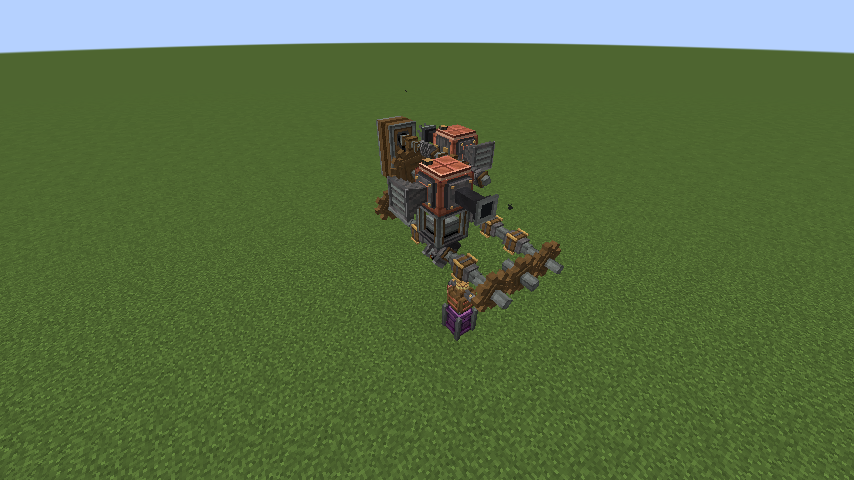

## Build an engine

- Inline, V, flat and rotary (Wankel) layouts, with coupled crankshafts for bigger engines
- Cam lobes that sit beside the cylinder block, so a V can run one camshaft in its valley and keep every head face free
  for pipes
- A **Bank Builder** that lays out a whole inline, V or flat bank in one click (it fits the spark plugs you carry, and
  lays a cam line beside the bank if you carry a camshaft and cam lobes), and a **Timing Tool** that sets the
  firing order for you
- **Torsional flex**: a crank twists under load, so past eight throws on one unbroken crankshaft an engine's rating
  falls a little for each extra throw, to at most 35 percent. A V12 or flat twelve loses nothing. It only lowers the
  rating and never harms anything

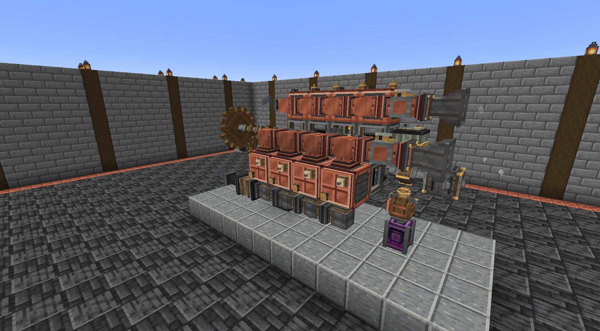
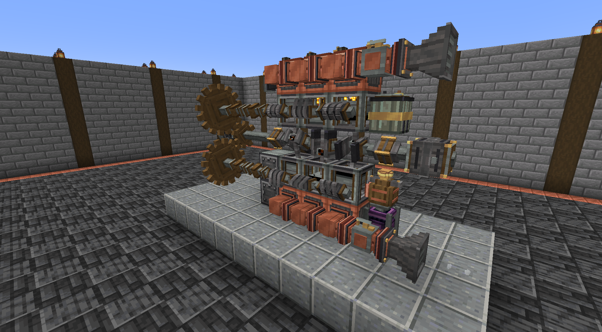

## Feed and tune it

- Air, fuel and exhaust plumbing with pipes, throttle bodies and fuel metering. Burns diesel, plant oil, gasoline and
  ethanol, with spark ignition where the fuel needs it
- A craftable fuel chain, all in Create basins: seeds to plant oil to diesel, sugar crops to ethanol, and biodiesel with
  glycerin on the side. The loop closes: glycerin goes into engine oil and coolant, and used oil is burned as fuel or
  recycled into oil or charcoal
- An **Exhaust Heat Exchanger** that turns engine exhaust into basin heat, so an engine can cook its own fuel, and into
  boiler heat, so the exhaust can make steam for Create steam engines on top of the engine's own power
- Oil film and lubrication, starters, batteries and alternators, with Forge Energy output
- An **oil sump that is the engine's service port**: one block against the engine takes its oil, coolant and pilot fuel
  from any face, so the cylinder heads keep their faces for air and fuel
- **Oil that goes off**: set the sump's Oil Exchange dial and a running engine changes its own oil, pushing out Used
  Oil that you burn, refine, coke into charcoal or let go. An Oil Filter slows the ageing
- **Engine temperature**: a cold engine drags until it warms through, and a cooled one breathes better. Coolant, or
  just water, goes into the same sump, so there is no radiator to fit. Nothing ever overheats or wears out
- **Warm-up and cooling**: a cold block burns fuel a little worse, and a Blaze Burner against the heat exchanger
  preheats it. A stopped engine ticks and its turbine wheel glows red as it cools
- **Plain-language diagnosis**: goggles name an engine Healthy, Running rough or Failing with the one cause to fix first,
  and the Dynamometer compares a new run with the last
- **Dual-fuel pilot injection**: pipe diesel into the sump's pilot tank and a compression engine with no spark plug
  lights gasoline or ethanol with a small pilot shot
- A forgiving early game: spark plug soot clears itself, goggles suggest fuel settings, and the Timing Tool can tune
  every injector in one click
- Governors and MAF sensors for the late game
- **Engine readouts**: a Display Link set against a crankshaft shows an engine's state, speed, load, temperature and oil
  on a display board or nixie tubes, and a comparator reads any of an oil sump's tanks, so a pump or an alarm can keep
  the oil topped up
- Fuel buckets say what they are on hover: their energy, whether they light by compression or need a spark plug, and how
  they take a cold start (other mods' fuels too)
- Other mods' fuels work too: anything tagged `c:diesel`, `c:gasoline`, `c:ethanol` or `c:plantoil`, or given an entry
  in the fuel data map

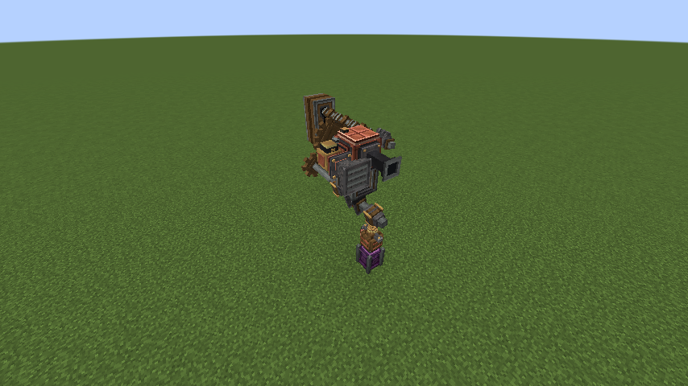

## Make it powerful

- Turbochargers (stacked, twin, variable-geometry, with anti-lag), superchargers (plain and variable-drive) and intercoolers, with the sound to
  match: a turbo whistle that climbs with the wheel, a blow-off flutter when redstone dumps the boost or the throttle lifts, anti-lag
  crackle, and a supercharger whine that rises with its shaft
- Precision cylinders, heads, pistons and injectors
- Flywheels that matter: a rough engine is rated for less, and rotating mass smooths it out
- A 13-gear transmission with an Auto mode that shifts to suit the engine, and a **Dynamometer** that draws an
  engine's torque and power curves
- A **Black Box** flight recorder that keeps ten minutes of an engine's speed, load and warmth and says why it stalled
- Engines that look and sound alive: exhaust colour that reads the mixture, flame from a hot pipe, a cough on starting,
  ticking as they cool, and a clatter or squeal when they run dry. Nothing runs underwater
- An exhaust note made up from the engine's speed and firing order, so a V-twin lopes, a six hums and a dead cylinder
  limps
- A **Muffler** that quiets the note, the bangs and the pops without costing the engine any power, and **Engine Casing**
  that joins into one plate and clads cylinders, pipes, cams, and Create's own shafts and cogwheels to hide the sprawl

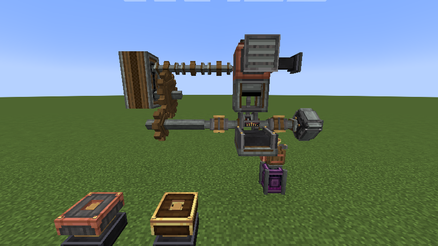
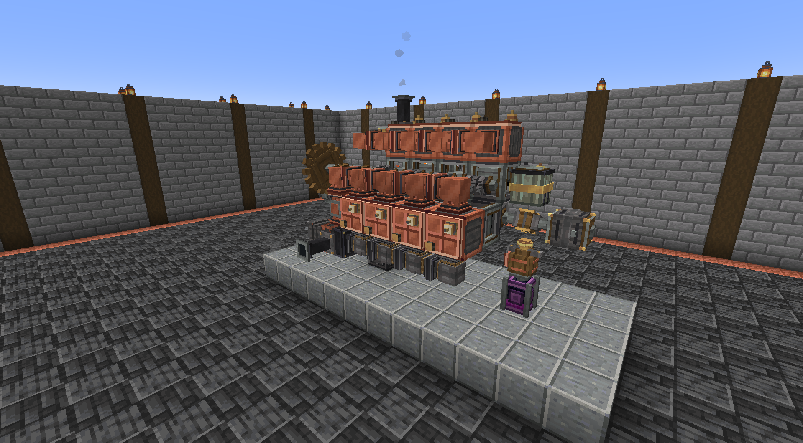
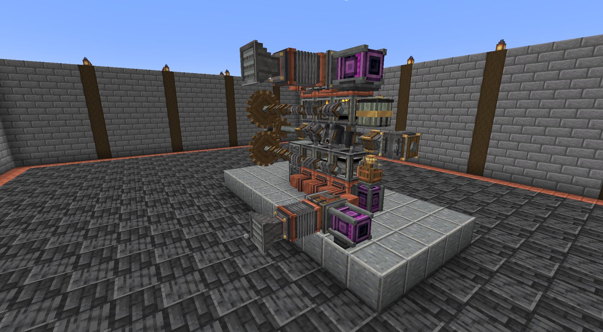

## Learn it

Every part has Engineer's Goggles diagnostics and a Ponder scene. Advancements reward actually using what you build,
grouped into tracks (builder, power, tuning, driveline, fuel, service) that each end in a capstone, with a Chief
Engineer advancement for finishing them all.

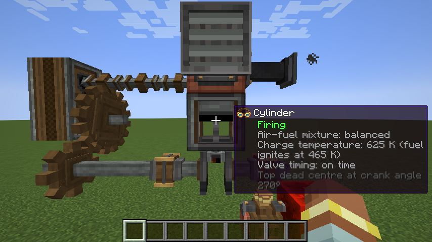
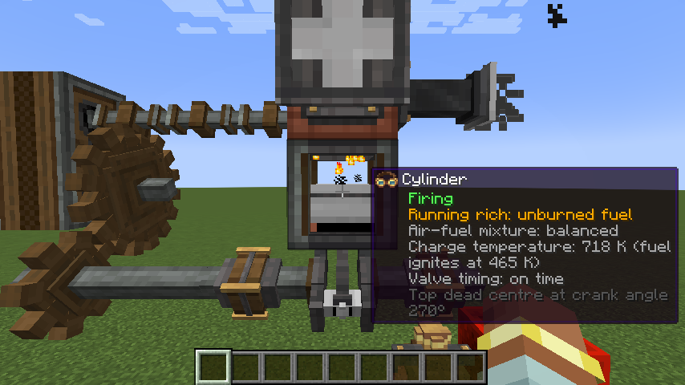

## Gallery

Every layout and every accessory, built and running in the mod.

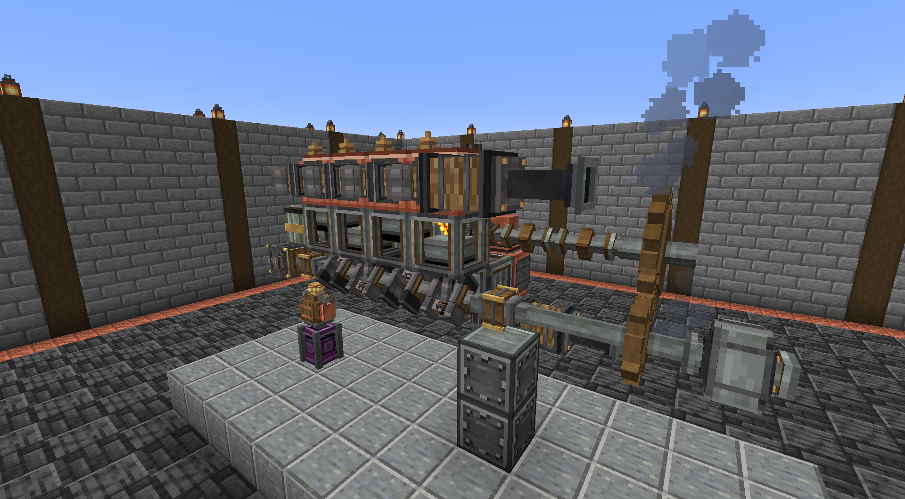
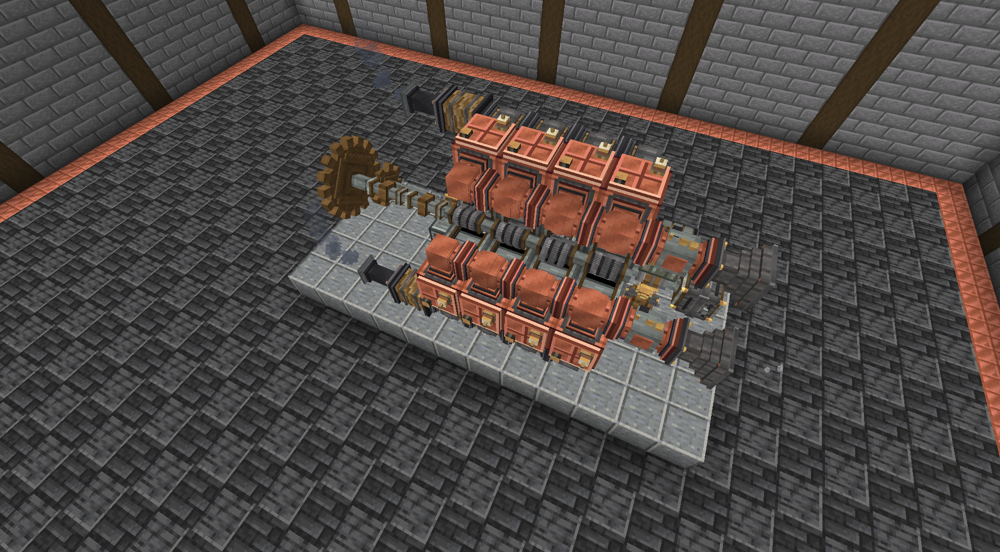
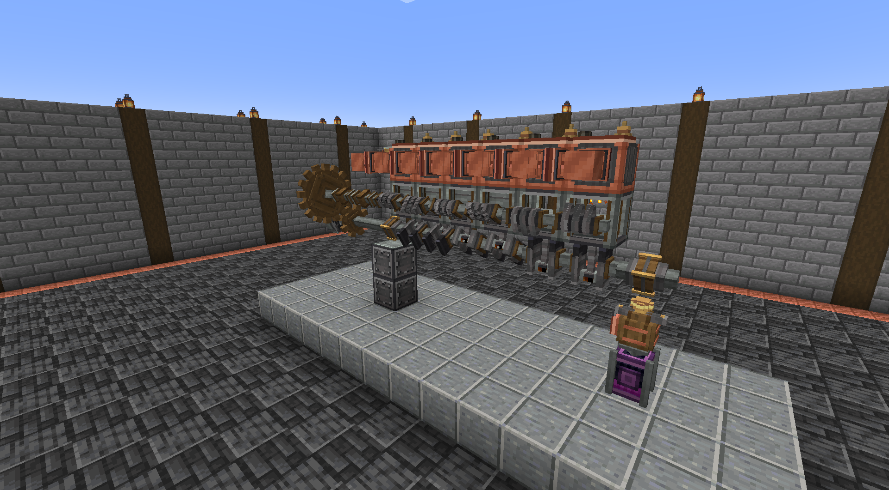
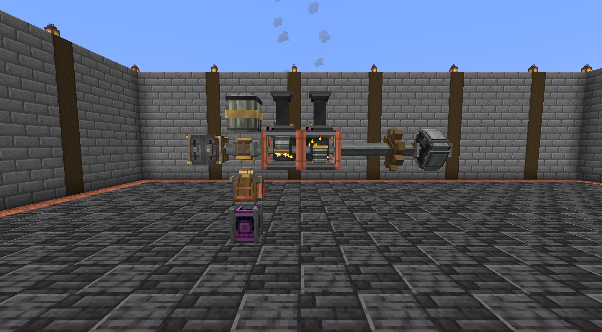
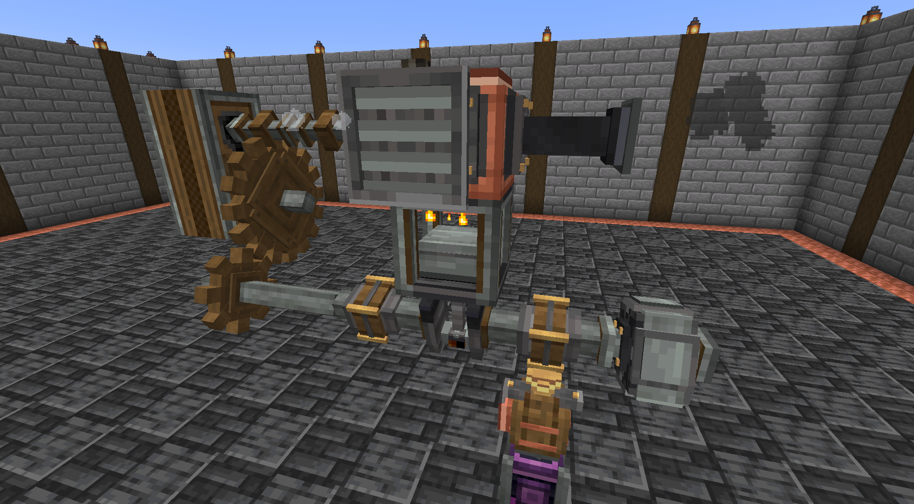
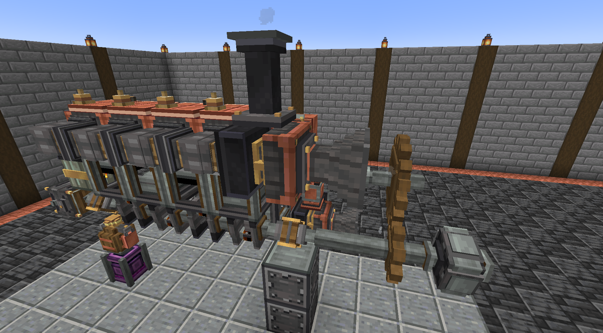
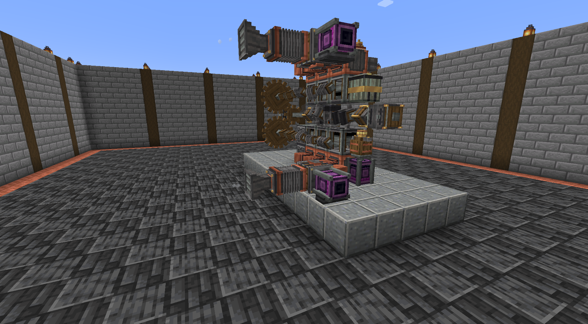
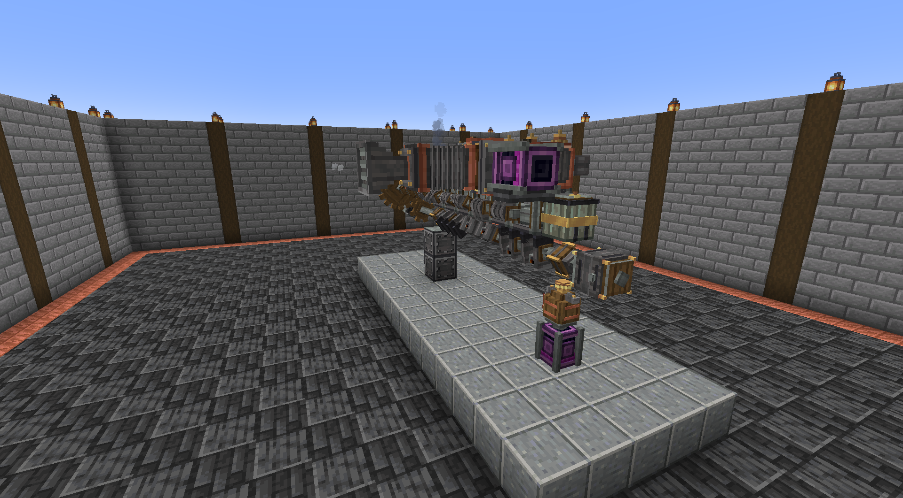
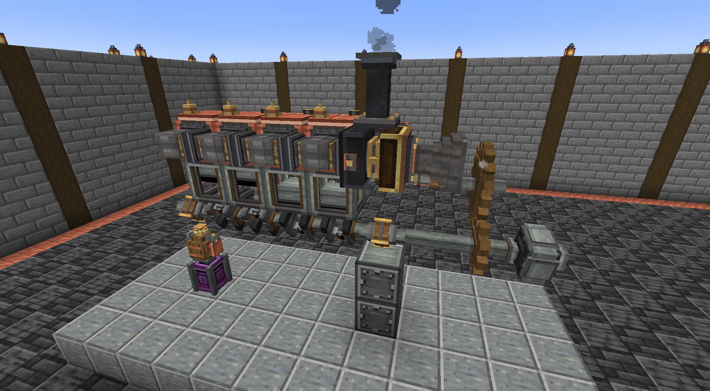
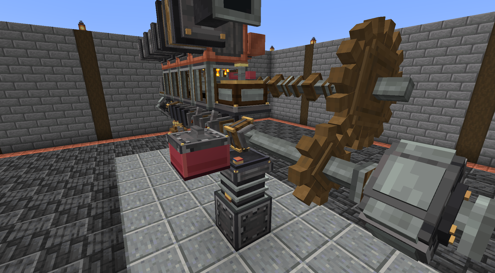
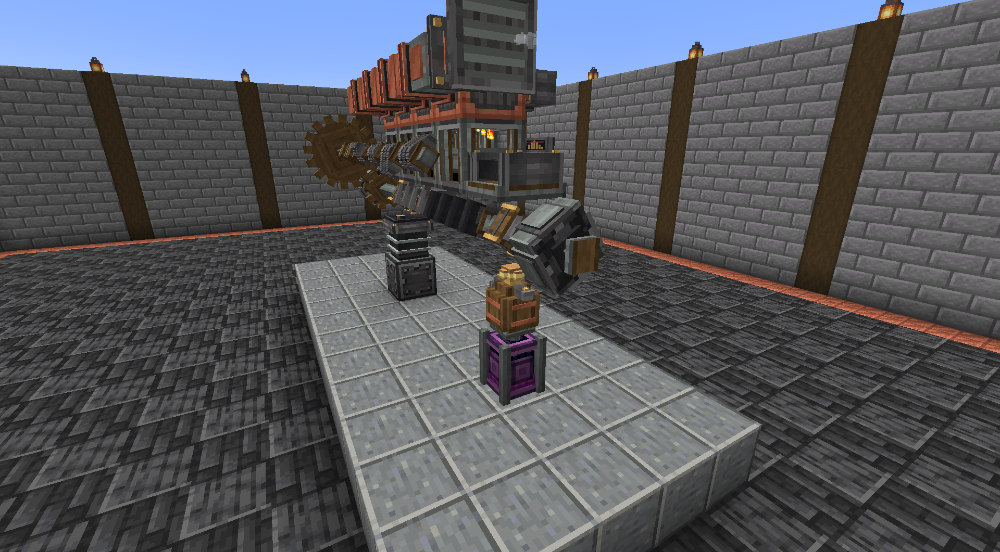

## Recommended: raise Create's RPM limit

Create caps rotation at 256 RPM by default, and engines hit that ceiling. Raise it: in
`serverconfig/create-server.toml` under `[kinetics]`, set `maxRotationSpeed` to 512 (higher works too). The engine simulation is
built to stay cheap at speed, and its torque rating follows the limit you set.

## For modpack makers

The server config (`serverconfig/create_engines-server.toml`) has `[balance]` multipliers and `[features]` switches, so
a pack can rebalance without code. Turning a feature off never removes blocks; they stop doing that job. The client
config thins out engine sound and particles on a big engine. Fuel properties are a datapack data map
(`data_maps/fluid/fuel.json`), so other mods' fluids can be made into fuels.

## Requirements

- Minecraft 1.21.1, NeoForge 21.1.219 or newer
- Create 6.0.10 (all of its own requirements, Flywheel and Ponder, come with it)
- Required on both the client and the server

## Links

- [Source and issue tracker](https://github.com/R-unic/create-engines)
- [Design notes](https://github.com/R-unic/create-engines/blob/master/docs/DESIGN.md), how the simulation works
```

## Changelog for 1.0.1

Casing that looks like casing, a few engine-behaviour fixes and livelier fire and air. No IDs, config keys or
advancements change, and worlds from 1.0.0 load as they are.
- Engine Casing now uses connected textures: a run of casing, and everything clad in it, reads as one riveted plate.
- Casing clads more. Besides crankshafts, throws, camshafts and cam lobes, it now covers cylinders, plain intake and
  exhaust manifolds, and Create's own shafts, cogwheels and large cogwheels (use it on them as you would Create's
  casings; they drop the shaft or cogwheel when broken). Throttles and sensors stay uncovered.
- Cam lobes are drawn as separate intake, exhaust and injector lobes, each turning to its own valve timing, so you can
  watch a valve open as its lobe comes round.
- Wrenching a casing off: sneak with a wrench to remove the casing and keep the part inside, instead of breaking it.
- The turbo wastegate chuffs when it swings open to hold the boost limit.
- Fixed: a stopped engine kept firing its effects on the client, and a crank zeroed by a rotation conflict now asks to
  turn again instead of staying still.
- Fixed: the slowest dyno point set the roughness loss peak, so a smooth even-firing engine could read about 18% rough at
  speed. The rating itself is unchanged, but smooth engines now read as smooth.
- Effects: fire in rotor housings and air drawn into intakes are drawn with new glowing particles, and intakes pull in a
  curling vortex of pale mist.
- Docs: the Modrinth summary and description are now pushed from this file on a release tag.

## Changelog for 1.0.0

The first stable release. Nothing in the engine's behaviour changes from 0.4.0; what changes is the promise.
- Stable from here through 1.x: block, item and fluid IDs, config keys and ranges, advancement IDs and the fuel data-map
  format. A release that changes how an existing engine behaves will say so here.
- The Transmission is back. It was removed in 0.4.0, and a player asked for it: it is compact, and its Auto mode shifts
  for you, which a Rotation Speed Controller does not. It is the same block with the same ID, recipe and advancements
  (Gear Up, Reverse Engineering, Gearhead, Let It Shift), and Full Driveline asks for every gear again. One placed before
  0.4.0 and lost on load does not come back by itself; place a new one.
- The Rev Limiter and Lambda Sensor existed only in development builds before 0.1.0. A world from one of those builds
  loses them on load too.
- Docs: the README lists every server config key group, including `alternatorEnergy`.

## Changelog for 0.4.0

Create's Rotation Speed Controller holds a shaft at a set speed and trades speed for torque at any ratio, and it keeps
what an engine drives steady however the engine's own speed moves. The Transmission did the same job worse, so it is
gone.
- Removed: the Transmission and its recipe, Ponder page and advancements (Gear Up, Reverse Engineering, Gearhead and Let
  It Shift). Any in an existing world disappear when it loads. Put a Rotation Speed Controller after the crankshaft
  instead. The Governor stays: it holds the engine's own speed, which a Rotation Speed Controller downstream does not.
- Full Driveline no longer asks for every gear: it wants a charged battery, a flywheel that smooths the engine and a
  governor under redstone.
- New: an exhaust heat exchanger under a fluid tank heats a boiler like a blaze burner (kindled is one level, seething
  two), so exhaust can run Create steam engines. Advancement: Combined Cycle.
- New: Display Link sources for engines (Engine Status, Speed, Load, Temperature, Oil Condition) on any crankshaft
  block, and Oil Sump Levels on a sump. A sump also gives a comparator signal for the tank its new dial names, so a pump
  or alarm can watch the oil. Advancements: Instrument Panel, Dipstick.
- New: the Muffler quiets an engine's exhaust note, bangs and pops and costs it no power. Engine Casing is plain cladding
  for hiding the sprawl. Advancements: Hush Now, Under the Hood.
- New: fuel buckets show their energy, how they ignite and how they take a cold start when hovered.
- The Bank Builder fits spark plugs and lays a cam line beside the bank (in the valley of a vee) when you carry them.
  Advancement: Cam Included. A cogwheel placed or broken between cranks now couples or uncouples them at once.
- Fixed: a schematic cannon built a finished cylinder, head or rotor housing with its pistons, rods, injectors, plugs
  and rotor for free. It now asks for them.
- A burning engine glows faintly: heads and rotor housings give off a little light while the charge fires.
- Engines at the edge of loaded chunks no longer pull in chunks nobody is near, and an engine whose chunk has unloaded no longer pulls it back in.
- Raise Create's maxRotationSpeed to 512 (higher works too) to let engines run past 256 RPM.
- Fuel recipes: plant oil takes six seeds or two saplings (100 mB and 50 mB), ethanol ferments from an apple or any
  mushroom and makes 50 mB a batch, biodiesel needs 25 mB of ethanol, and gasoline needs only a Blaze Burner's heat.

## Changelog for 0.3.0

Livelier engines. Exhaust tells the truth: a thin haze when the mixture is right, black when rich, white vapour until the
block warms, a blue cast when fuel has thinned the oil, and a crack of flame when unburned fuel meets a hot pipe. Engines
cough as they catch, knock as they die, tick as they cool, squeal and spark when they run dry, and draw air in at their
intakes. New recordings and white puff and spark particles back all of it.
- Warm-up and cooling: a cold block burns fuel a little worse and warms quickest at idle. A Blaze Burner against the heat
  exchanger preheats it. A stopped engine ticks and shimmers, and its turbine wheel glows red as it cools.
- Plain-language diagnosis: goggles name an engine Healthy, Running rough or Failing with the one cause to fix first, and
  say why a cylinder misfired. The Dynamometer shows how a new run compares with the last. Two new Ponder pages cover why
  an engine will not start and why it runs badly.
- Nothing burns underwater. Water against a cylinder, head or rotor housing stops the engine wherever its pipes lead, and a
  flooded intake or exhaust shuts as well. Engine parts are no longer washed away by flowing water.
- New advancements: Hard Start, Preheated and Flooded.
- New client settings: `engineNoteVolume` and `mechanicalVolume`.

## Changelog for 0.2.0

New art. The mod's metals are repainted to match Create's, with the same rims and strokes in Create's own colours. Vanilla's
copper, magma, lava, smooth stone and trapdoor are gone from the models, the fluids have their own thin and thick textures in
place of tinted water, and hot metal on a heat exchanger gives its own light. The advancement tab has a tread plate background.

## Changelog for 0.1.0

First public release. Everything in the description above.

## Publishing

Uploads are automatic, from `.github/workflows/publish.yml`. It builds with the tests, then uploads the jar to
Modrinth and CurseForge. The changelog is the `## Changelog for X.Y.Z` section of this file when one matches the tag,
otherwise the commit subjects since the last tag.

| Do this | You get |
|---|---|
| `git tag v0.2.0 && git push origin v0.2.0` | a release |
| `git tag v0.2.0-beta.1 && git push origin v0.2.0-beta.1` | a beta (`-alpha` makes an alpha, `-rc` a beta) |
| push to the `prototype` branch, or run the workflow by hand | an alpha named `<mod_version>-prototype.<run number>` |

On a release tag, `.github/workflows/gallery.yml` also pushes the summary and the description above to the Modrinth page
(`scripts/sync-modrinth-description.sh`) and replaces the gallery. This needs the token's "Write projects" scope. CurseForge
has no API for either, so its description and gallery are still pasted in by hand.

The version in the jar comes from the tag, so `mod_version` in `gradle.properties` only needs bumping for the
prototype names.

One-time setup in the GitHub repository (Settings, Secrets and variables, Actions):

- Secret `MODRINTH_TOKEN`: a Modrinth personal access token with the "Create versions" scope
  (modrinth.com/settings/pats).
- Secret `CURSEFORGE_TOKEN`: a CurseForge API token (authors.curseforge.com/account/api-tokens).
- Variable `CURSEFORGE_ID`: the numeric project ID, on the CurseForge project page under About Project.
- Variable `MODRINTH_ID` is optional; it defaults to the slug `create-engine-engineer`.

Push the repository first so the description's image links resolve. Both sites review a project before it goes
public, and Modrinth may not accept uploads until its first review passes. While a Modrinth project is unapproved, the slug
cannot be looked up without the token's "Read projects" scope: add that scope, or set `MODRINTH_ID` to the project's ID.

A failed upload does not stop the other site, but the run still fails. Rerunning it uploads again to any site that
succeeded, so when one site worked, upload to the other by hand with the jar from the run's artifacts.
